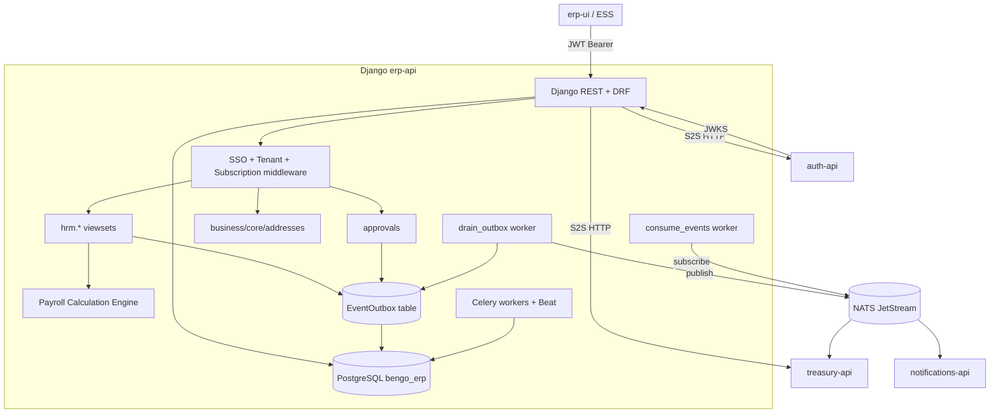
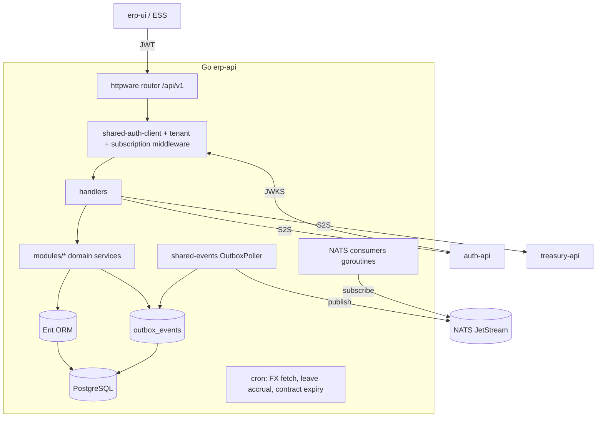

# erp-api Architecture (Current Django + Target Go)

> Authoritative blueprint for the Django → Go revamp of `erp-api`.
> Current code audited at `D:\Projects\Codevertex\erp\erp-api` (Django 5.0, Python 3.11).
> Target: Go 1.26+, matching `inventory-service`, `pos-service`, `ordering-service`, `marketflow`.

---

## 1. What erp-api is (after platform decomposition)

The ERP was decomposed into platform microservices. What **remains** in `erp-api` is the
**HR + internal-ops service**. Everything money/stock/CRM/order/POS-related was moved out:

| Decomposed-out domain | New owner |
|---|---|
| products / stock / vendor / procurement / manufacturing / asset-register | `inventory-api` |
| finance / payments / tax / budgets / reconciliation / asset-depreciation | `treasury-api` |
| crm (contacts/leads/pipeline/campaigns) | `marketflow` |
| cart / order | `ordering-backend` |
| pos | `pos-api` |
| notifications (templates/providers/delivery) | `notifications-api` |
| auth (identity, tenants, outlets, global RBAC, branding) | `auth-api` (SSO) |

`erp-api` keeps: **HRM** (employees, payroll, payroll-settings, leave, attendance,
appraisals, performance, recruitment, training), **approvals**, **business config**,
**addresses**, **core reference data**, plus the platform-system apps (`task_management`,
`error_handling`, `caching`, `integrations`, trimmed `authmanagement` SSO shadow).

Source of truth: `ProcureProKEAPI/settings.py` `INSTALLED_APPS` (lines 84–116) and
`ProcureProKEAPI/urls.py` (lines 52–73).

---

## 2. Current Django app inventory

Verified present (each is a Django app with `models.py`, `views.py`, `serializers.py`,
`urls.py`, `migrations/`):

| App | Purpose | Models file | Migrations |
|---|---|---|---|
| `authmanagement` | SSO client + thin `CustomUser` shadow, RBAC (Django groups), 2FA/security, backups, user prefs, `AuthTenant`/`AuthOutlet` shadows | `authmanagement/models.py` (348 ln) + `authmanagement/security.py` | 5 |
| `core` | Reference data (Regions, Departments, Projects, Banks), ExchangeRate, RegionalSettings, Blog, perf metrics, middleware, base viewsets | `core/models.py` (425 ln) | 16 |
| `business` | Business/tenant config, Branch, BrandingSettings, TaxRates, PrefixSettings, DocumentSequence, ServiceTypes, PickupStations | `business/models.py` (595 ln) | 6 |
| `approvals` | Centralized approval workflow engine (generic FK) | `approvals/models.py` (428 ln) | 4 |
| `addresses` | AddressBook (Jumia-style), DeliveryRegion, AddressValidation | `addresses/models.py` (268 ln) | 2 |
| `integrations` | **NATS outbox** (`EventOutbox`), S2S client, SSO helpers feeders, FX (`ExchangeRateAPISettings`), branding/taxes/notifications/tenant-sync accessors | `integrations/models.py` (166 ln) | 6 |
| `task_management` | Generic async-task tracker (Task, TaskLog, TaskTemplate) + Channels consumer | `task_management/models.py` (197 ln) | 1 |
| `error_handling` | Centralized error tracking (Error, ErrorLog, ErrorPattern) | `error_handling/models.py` (179 ln) | 1 |
| `caching` | Cache management endpoints (no models) | — | 0 |
| `hrm.employees` | Employee, SalaryDetails, HRDetails, Contract, ContactDetails, NextOfKin, Documents, JobTitle, JobGroup, WorkersUnion, EmployeeBankAccount | `hrm/employees/models.py` (533 ln) | 4 |
| `hrm.payroll` | Payslip, Earnings, Deductions, Benefits, Loans, Advances, Loss/Damages, ExpenseClaims, CustomReport + **calculation engine** | `hrm/payroll/models.py` (436 ln) + `services/` | 2 |
| `hrm.payroll_settings` | Formulas, FormulaItems, SplitRatio, Relief, PayrollComponents, WithHoldingtax, BenefitTaxes, GeneralHRSettings, ScheduledPayslip | `hrm/payroll_settings/models.py` (454 ln) | 2 |
| `hrm.leave` | LeaveCategory, LeaveEntitlement, LeaveRequest, LeaveBalance, LeaveLog, PublicHoliday | `hrm/leave/models.py` (134 ln) | 2 |
| `hrm.attendance` | WorkShift(+Schedule), AttendanceRecord, AttendanceRule, ShiftRotation, ESSSettings, Timesheet(+Entry), shift-planner roster | `hrm/attendance/models.py` (565 ln) + `shift_planner_models.py` | 4 |
| `hrm.appraisals` | AppraisalCycle/Template/Question/Appraisal/Response, Goal, GoalProgress | `hrm/appraisals/models.py` (142 ln) | 3 |
| `hrm.performance` | MetricCategory, PerformanceMetric, EmployeeMetric, MetricTarget, PerformanceReview, ReviewMetric | `hrm/performance/models.py` (150 ln) | 1 |
| `hrm.recruitment` | JobPosting, Candidate, Application + onboarding (EmployeeOnboarding, OnboardingTask) | `hrm/recruitment/models.py` (72 ln) + `onboarding_models.py` | 2 |
| `hrm.training` | TrainingCourse, TrainingEnrollment, TrainingEvaluation | `hrm/training/models.py` (52 ln) | 1 |

`reports/` is an empty namespace (reporting is implemented inside `hrm/payroll/services/reports_service.py`
and `core` dashboards). `hrm.analytics` and `hrm.reports` are non-app helper packages.

Live DB `bengo_erp` (local PostgreSQL 17) has **158 tables**. (Local dev data is cleared;
only `auth_group`=14, `auth_permission`=592 are populated — see `data-migration.md`.)

---

## 3. Request lifecycle & middleware chain (Django)

`settings.py` `MIDDLEWARE` (lines 248–274), in order:

```
PrometheusBeforeMiddleware
SecurityMiddleware (django)
WhiteNoiseMiddleware                       # static files
SessionMiddleware
CorsMiddleware
CommonMiddleware
CsrfViewMiddleware
AuthenticationMiddleware (django)
authmanagement.sso_middleware.SSOAuthenticationMiddleware       # decode JWT -> request.auth_claims (no enforce)
authmanagement.sso_middleware.TenantOutletContextMiddleware     # request.tenant_id/outlet_id + JIT tenant/outlet shadow sync
authmanagement.sso_middleware.SubscriptionGatingMiddleware      # mutations-only 403 if subscription_inactive
MessageMiddleware / XFrameOptions / LocaleMiddleware
PrometheusAfterMiddleware
core.performance.PerformanceMiddleware     # writes core_api_request_metrics
core.security.SecurityMiddleware           # extra security headers/checks
authmanagement.middleware.SiteWideConfigs
core.middleware.CoreMiddleware
core.middleware.CurrencyContextMiddleware  # X-Currency sync
hrm.payroll.middleware.PayrollFormulaMiddleware       # ensures payroll formulas exist
hrm.payroll_settings.middleware.TaxFormulaMiddleware  # ensures tax formulas exist
hrm.attendance.middleware.DefaultShiftMiddleware      # auto-create "Regular" shift
business.middleware.BusinessConfigs
```

DRF auth stack (`REST_FRAMEWORK`, lines 572–612):
`SSOJWTAuthentication` (RS256 via auth-api JWKS, JIT-provision local user) → `TokenAuthentication`
→ `SessionAuthentication` → `BasicAuthentication`. Default permission `IsAuthenticated`.
Pagination `core.pagination.StandardResultPagination` (page size 100). Exception handler
`core.exceptions.api_exception_handler`. Throttling anon 60/min, user 600/min.

### Auth / multi-tenancy / RBAC

- **Identity**: auth-api mints RS256 JWTs. `authmanagement/sso.py:SSOJWTAuthentication` validates
  against JWKS (`AUTH_JWKS_URL`), wraps claims in `Claims`, and JIT-provisions a thin
  `CustomUser` shadow keyed on `external_id` (= JWT `sub`). No passwords stored for SSO users.
- **Tenant context**: `TenantOutletContextMiddleware` sets `request.tenant_id`. Platform owners
  may override via `?tenantId=` (platform-owner pattern). `request.outlet_id` from `X-Outlet-ID`.
  JIT-syncs `AuthTenant`/`AuthOutlet` shadows from auth-api (`integrations/tenant_sync.py`).
- **Service RBAC (Layer 3)**: Django **groups** are the ERP "service roles"; Django **permissions**
  are fine-grained. `GET /api/v1/auth/me/` (`authmanagement/auth_me.py`) returns service roles +
  resolved bare-codename permissions merged with SSO claims for the frontend to gate UI.
- **Subscription gating**: `SubscriptionGatingMiddleware` reads `sub_status`/`sub_features` baked
  into the JWT; blocks mutations with `403 {code:"subscription_inactive"}` when inactive (gated by
  `SUBSCRIPTION_GATING_ENABLED`). See `integrations.md`.

### Eventing (transactional outbox)

`integrations/events.py` + `integrations/models.py:EventOutbox`:
1. Domain code calls `publish_event(event_type, payload, aggregate_type, aggregate_id, tenant_id)`
   inside the DB transaction → writes an `EventOutbox` row (status `pending`).
2. `manage.py drain_outbox [--loop]` publishes pending rows to NATS JetStream, marks `published`,
   retries up to `EVENTS_MAX_ATTEMPTS` (default 10) then parks `failed`.
3. `manage.py consume_events` runs NATS consumers registered in `events.CONSUMER_HANDLERS`
   (e.g. `auth.tenant.*`, `auth.outlet.*`, `treasury.payroll.disbursed`).
   Envelope: `{id, tenant_id, aggregate_type, aggregate_id, event_type, payload, timestamp, version, source}`.

### Background jobs

- **Celery** (`ProcureProKEAPI/celery.py`, broker = Redis): payroll processing, email distribution,
  voucher generation, report generation, FX fetch. Queues defined in `CELERY_TASK_ROUTES`
  (lines 171–191). Celery Beat: `fetch_exchange_rates` daily at 00:00 (`integrations/tasks.py`).
- **APScheduler**: contract-expiry checks (`urls.py` lines 23/97–99, currently commented out).
- **Django Channels / Daphne** (ASGI): WebSocket task-progress + payroll consumers
  (`task_management/consumers.py`, `hrm/payroll/consumers.py`).

### Component diagram (current)



---

## 4. Payroll calculation engine (the crown-jewel logic to port)

`hrm/payroll/services/core_calculations.py:PayrollCalculationEngine` is the single source of truth
for Kenyan statutory payroll. Thin wrappers in `hrm/payroll/functions.py` delegate to it.

Capabilities (all **data-driven** via `Formulas`/`FormulaItems`/`SplitRatio`, effective-dated):
- Progressive **PAYE** income tax (`calculate_income_tax`) + personal relief resolution
  (`resolve_personal_relief`: formula → Relief row → `DEFAULT_PERSONAL_RELIEF=2400`).
- **NSSF** tiered (Tier 1 / Tier 2) employee+employer (`calculate_nssf_contribution`).
- **SHIF** (2025+) and legacy **NHIF** (`calculate_shif_contribution`/`calculate_nhif_contribution`);
  cutover is config-driven via `use_nhif_for_period()` (falls back to a hardcoded NHIF table +
  `2025-01-01` cutover only if no formula configured).
- **Housing Levy** (`calculate_housing_levy`).
- Employee recoverables: loans (reducing-balance/fixed + FBT), advances, loss/damages, non-cash
  benefits — capped at outstanding, effective-dated (`calculate_employee_deductions`).
- Deduction **phasing/ordering** (`before_tax` → `after_tax` → `after_paye` → `final`) via
  `PayrollComponents.deduction_phase/priority` and `Formulas.deduction_order` JSON
  (`services/dynamic_deduction_engine.py`).
- Reports: P9, P10A (`services/p10a_formatter.py`), statutory deductions, bank net-pay, muster roll,
  withholding tax, variance (`services/reports_service.py`).
- Approval + notification services (`services/payroll_approval_service.py`, `payroll_notification_service.py`).

**Payroll → money flow** (`hrm/payroll/treasury_integration.py`): on finalisation the ERP
(1) publishes `erp.payroll.processed` (treasury posts the GL journal) and
(2) calls treasury S2S `POST /api/v1/s2s/{tenant}/payouts/disburse` for net pay, then consumes
`treasury.payroll.disbursed` to mark payslips published/paid. The ERP never posts ledgers or moves cash.

---

## 5. Configuration & env vars (Django)

> **Gotcha**: `settings.py` does NOT load `.env`. Config is read from process env (`os.getenv`);
> `DATABASE_URL` is preferred, else `DB_NAME` (default `bengo_erp`) / `DB_USER` / `DB_PASSWORD` etc.

Key env vars (`settings.py`):

| Var | Default | Meaning |
|---|---|---|
| `DJANGO_SECRET_KEY` / `SECRET_KEY` | insecure dev key | Django secret (must be set in prod) |
| `DEBUG` | `true` | Debug mode (CORS allow-all when true) |
| `DATABASE_URL` / `DB_*` | `postgres@localhost/bengo_erp` | Postgres connection |
| `REDIS_URL` | `redis://localhost:6379/0` | Celery broker + cache |
| `SSO_ENABLED` | `false` | Enable SSO JWT auth + middleware |
| `SUBSCRIPTION_GATING_ENABLED` | `false` | Enable mutations-only subscription gate |
| `AUTH_API_URL` | `auth-api.auth.svc...:4101` | auth-api base URL |
| `AUTH_JWKS_URL` / `AUTH_AUDIENCE` / `AUTH_ISSUER` | derived/empty | JWT validation |
| `INTERNAL_SERVICE_KEY` | `""` | S2S `X-API-Key` shared secret |
| `TREASURY_API_URL`, `INVENTORY_API_URL`, … | K8s DNS | downstream service URLs |
| `EVENTS_ENABLED` | `false` | gate outbox publish/consume |
| `EVENTS_NATS_URL` | `nats.messaging.svc...:4222` | NATS JetStream URL |
| `EVENTS_SOURCE_SERVICE` | `erp` | event `source`/aggregate prefix |
| `EVENTS_MAX_ATTEMPTS` | `10` | outbox retry budget |
| `MEDIA_ROOT` / `BACKUP_ROOT` / `USE_S3` / `AWS_*` | local | media + backup storage |
| `FRONTEND_URL` / `BACKEND_URL` / `FORCE_HTTPS` | localhost | public-link generation |

---

## 6. Deployment (current)

- **Dockerfile**: multi-stage `python:3.11-slim`; collects static (WhiteNoise) at build;
  runtime non-root `appuser`, port `4000`, healthcheck `GET /api/v1/core/health/`;
  installs `postgresql-client` for backup/restore. Entrypoint runs migrations on every start
  (`scripts/entrypoint.sh`).
- **k8s/**: `db-init-job.yaml` + `monitoring/` (Prometheus). Manifests are mostly platform-managed
  (ArgoCD GitOps). `build.sh` (28 KB) drives CI image build.
- **WSGI/ASGI**: `passenger_wsgi.py`/`web.config` (legacy Passenger), `wsgi.py`, `asgi.py` (Channels).

---

# TARGET Go architecture

Mirror the platform Go services (`inventory-service/inventory-api` is the closest analogue).
The new service is **`erp-service/erp-api`** (Go module e.g. `github.com/bengobox/erp-service`).

## T1. Stack

| Concern | Choice (matches platform) |
|---|---|
| Language | Go 1.26+ |
| ORM / schema | **Ent** (`entgo.io/ent`) — schema-as-code in `internal/ent/schema/*.go` |
| Migrations | **Atlas** (`ariga.io/atlas`) — versioned SQL in `migrations/`, run by entrypoint (not auto in prod) |
| DB | PostgreSQL (pgx/v5 pool + Ent `database/sql` driver) |
| Auth | `github.com/Bengo-Hub/shared-auth-client` (JWKS RS256 + Claims + middleware) |
| HTTP middleware | `github.com/Bengo-Hub/httpware` (CORS, request-id, tenant ctx, recovery) |
| Events | `github.com/Bengo-Hub/shared-events` (`OutboxPoller` + NATS JetStream) |
| Cache | `github.com/Bengo-Hub/cache` (Redis) |
| Config | `kelseyhightower/envconfig` + `joho/godotenv` |
| Logging | `go.uber.org/zap` |
| Telemetry | OTLP (optional) + `/metrics` |

## T2. Repo layout (copy inventory-api)

```
erp-service/erp-api/
  cmd/
    api/main.go            # server entrypoint
    migrate/main.go        # atlas migration runner
    seed/main.go           # RBAC roles, payroll formulas, reference data seeds
  config/                  # config.yaml / .env templates
  internal/
    app/app.go             # wiring: db, redis, nats, ent, outbox poller, consumers, router
    config/config.go       # envconfig structs (App/HTTP/Postgres/Redis/Events/Auth/Services/Media)
    ent/                   # generated; ent/schema/*.go authored
    http/
      handlers/            # per-domain HTTP handlers (health, employees, payroll, ...)
      middleware/          # auth, tenant, subscription gate (wrap httpware + shared-auth-client)
      router/              # route registration -> /api/v1/...
    modules/               # domain logic (one package per bounded context)
      employees/  payroll/  payrollsettings/  leave/  attendance/
      appraisals/ performance/ recruitment/ training/
      approvals/  business/ addresses/ core/ rbac/ tasks/ errors/
      consumers/           # NATS event consumers (auth.tenant.*, treasury.payroll.disbursed, ...)
    platform/
      database/ cache/ events/ subscriptions/ treasury/ auth/  notifications/
    services/usersync/     # JIT user/tenant/outlet sync from auth-api
    shared/logger/ shared/...
  migrations/              # atlas versioned migrations
  Dockerfile  build.sh  k8s/
```

## T3. Module → Go bounded-context mapping

| Django app(s) | Go module package | Notes |
|---|---|---|
| `hrm.employees` | `modules/employees` | Employee + SalaryDetails + HRDetails + Contract + contacts/kin/docs/banks; the FK hub |
| `hrm.payroll` + `hrm.payroll_settings` + `services/` | `modules/payroll` (+ `payrollengine` subpackage) | Port the calculation engine first; effective-dated formulas |
| `hrm.leave` | `modules/leave` | accrual job → cron/consumer |
| `hrm.attendance` (+ shift planner) | `modules/attendance` | WorkShift, AttendanceRecord, rules, rosters, ESS settings, timesheets |
| `hrm.appraisals` / `performance` / `recruitment` / `training` | `modules/{appraisals,performance,recruitment,training}` | mostly CRUD |
| `approvals` | `modules/approvals` | DONE — typed tenant-scoped engine (ApprovalWorkflow/Step/Request/StepAction), approver resolution vs Employee/HRDetails, wired into leave+appraisals |
| `business` | `modules/business` | DONE (slim) — CompanySettings + DocumentSequence (inventory-api CAS numbering). NO branding (auth-api SoT), NO tax rates (payroll tables), NO ServiceTypes/PickupStations (ordering-service) |
| `addresses` | — | NOT built — address_book/delivery-region belong to ordering-service (plan §0a); HR-owned employee contact address lives on ContactDetails |
| `core` reference | `modules/business` + `modules/fx` + reference schemas | Regions/Departments + ExchangeRate(+ExchangeRateAPISettings FX cron) + AppSetting. NO Projects (projects-service), NO Bank masters (treasury/payment-rail) |
| `reports` | `modules/reports` | DONE — P9/P10A/SHIF/NHIF/NSSF/NITA/WHT/statutory/bank-schedule/variance + headcount/leave/payroll summaries |
| `task_management` | `modules/tasks` | DONE — Task+TaskComment+TaskLog, status FSM/progress/assignment; internal tracker (distinct from projects-service) |
| `error_handling` | `modules/errors` or platform middleware | prefer structured logging + Sentry/OTLP; keep table only if UI needs it |
| `authmanagement` | `modules/rbac` + `platform/auth` + `services/usersync` | service-role RBAC (Ent roles/perms like inventory-api `inventoryrole`/`inventorypermission`), `GET /auth/me`, tenant/outlet shadows |
| `integrations` | `platform/events` + `platform/treasury` + `platform/auth` + cron | outbox via shared-events; FX fetch via cron goroutine |
| `caching` | `platform/cache` | shared cache lib |

## T4. Cross-cutting decisions

- **Multi-tenancy**: every tenant-scoped table gets `tenant_id uuid` + composite indexes
  `(tenant_id, ...)`, like inventory-api. Handlers MUST filter by `claims.TenantID`
  (platform-owner `?tenantId=` override). **This fixes the current near-total lack of tenant
  scoping** (see `gaps-and-bugs.md`).
- **IDs**: prefer UUIDv7 PKs (platform convention) over Django's `BigAutoField`. Keep a mapping
  table during migration (see `data-migration.md`).
- **Money**: use `decimal`-backed types (string-serialized) consistent with the platform decimal
  migration; never `float`. Payroll currently mixes `DecimalField(2)` and `(4)` — normalize.
- **Events**: keep the SAME subjects (`erp.payroll.processed`, `erp.email.requested`,
  `erp.notification.requested`) so notifications-api/treasury contracts are unchanged.
- **Auth/me two-step**: keep `GET /api/v1/auth/me/` returning service roles + permissions.
- **Outbox**: use `shared-events` `OutboxPoller` against an `outbox_events` Ent table — drops the
  custom `drain_outbox`/`consume_events` commands.

### Target component diagram



See `integrations.md` (contracts), `erd.md` (schema), `data-migration.md`, `gaps-and-bugs.md`,
`revamp-plan.md`, and `sprints/` for the execution plan.
