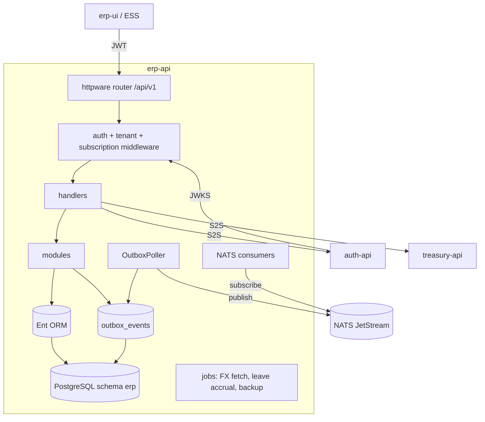

# erp-api Architecture

> Go 1.26 service, matching `inventory-api`, `pos-api`, `ordering-backend` and `treasury-api`.
> Module path `github.com/Bengo-Hub/erp-api`. Every statement here was checked against the code on `main`.

---

## 1. What erp-api is

`erp-api` is the **HR and internal-ops service**. Money, stock, CRM, orders and POS live in other services:

| Domain | Owner |
|---|---|
| products, stock, vendors, procurement, manufacturing, asset register | `inventory-api` |
| finance, payments, tax, budgets, reconciliation, depreciation | `treasury-api` |
| CRM (contacts, leads, pipeline, campaigns) | `marketflow` |
| cart and orders | `ordering-backend` |
| POS | `pos-api` |
| notifications (templates, providers, delivery) | `notifications-api` |
| identity, tenants, outlets, global RBAC, branding | `auth-api` (SSO) |

`erp-api` owns: **HRM** (employees, payroll, payroll settings, leave, attendance, appraisals,
performance, recruitment, training), **approvals**, **business config**, a task tracker and FX rates.

---

## 2. Stack

| Concern | Choice |
|---|---|
| Language | Go 1.26 |
| ORM and schema | Ent (`entgo.io/ent`), schema as code in `internal/ent/schema` |
| Migrations | Atlas versioned SQL in `internal/ent/migrate/migrations`, applied by `cmd/migrate` |
| Database | PostgreSQL, schema `erp` (the connection pins `search_path` to it) |
| Auth | `shared-auth-client` (JWKS RS256, claims, middleware) |
| HTTP middleware | `httpware` (CORS, request id, logging, recovery) |
| Events | `shared-events` (`OutboxPoller` over NATS JetStream) |
| Cache | `cache` (cache-aside over Redis) |
| Service to service | `shared-service-client` (retry, circuit breaker, tracing) |
| Pagination | `pagination` (`data/total/limit/page/hasMore` envelope) |
| Rate limiting | `shared-ratelimit` |
| Config | `kelseyhightower/envconfig`, see `internal/config/config.go` |
| Logging | `go.uber.org/zap` |

---

## 3. Repository layout

```
cmd/
  server/                   HTTP server entrypoint
  migrate/                  Atlas migration runner (the server never auto-migrates in prod)
  seed/                     RBAC permissions and system roles (idempotent)
  seed-payroll/             global statutory rate set under the system tenant
  seed-defaults/            per-tenant HR reference data (idempotent)
  seed-contracts/           back-fill contracts for employees that have none
  sync-employees/           one-time projection of auth-api users into employees
  backfill-tenant-defaults/ bootstrap one tenant that missed the seeders
internal/
  config/                   envconfig structs
  ent/                      generated Ent code; schema/ is authored
  http/                     handlers, middleware, router, swagger docs
  modules/                  one package per bounded context
  platform/                 auth, cache, database, events, lookups, media, subscriptions, treasury
  services/usersync/        just-in-time tenant, outlet and user sync from auth-api
  shared/logger/
scripts/entrypoint.sh       container start: migrate, seed, then serve
```

### Modules

| Package | Responsibility |
|---|---|
| `employees` | employee, salary, HR details, contracts, contacts, next of kin, documents, bank accounts |
| `payroll` (+ `payrollengine`) | payslips, earnings, deductions, loans, advances, expense and per diem claims, attendance deductions, background runs, reports; the statutory calculation engine |
| `payrollsettings` | effective-dated formulas, reliefs, components, HR settings |
| `leave` | categories, entitlements, requests, balances, accrual job |
| `attendance` | shifts, records, rules, rosters, timesheets, ESS settings |
| `appraisals`, `performance`, `recruitment`, `training` | people management |
| `approvals` | typed, tenant-scoped approval engine wired into leave and appraisals |
| `business`, `orgsettings`, `defaults` | company settings, document sequences, per-tenant defaults |
| `fx` | exchange rates and the scheduled fetch |
| `reports` | P9, P10A, SHIF, NHIF, NSSF, NITA, withholding tax, bank schedule, variance, HR analytics |
| `tasks` | internal task tracker with comments and logs |
| `rbac` | service roles and permissions, `GET /auth/me` |
| `backup`, `consumers`, `contracts`, `staffpurchase`, `docs` | backups, NATS consumers, contract lifecycle, staff purchase, document helpers |

---

## 4. Request lifecycle

1. `httpware` middleware (request id, logging, recovery, CORS).
2. `shared-auth-client` validates the RS256 JWT against auth-api's JWKS and builds the claims.
3. Tenant and outlet context: the tenant comes from the claims; a platform owner may override it with
   `?tenantId=`; the outlet comes from `X-Outlet-ID`. Tenant and outlet shadows are synced from
   auth-api on demand (`services/usersync`).
4. RBAC: handlers check fine-grained permission codes. `GET /api/v1/auth/me` returns the service
   roles and permissions for the UI to gate on.
5. Subscription gating: plan-gated features ask subscriptions-api for the tenant's entitlements
   (cached, fails open) and answer `403 feature_not_available` when the plan lacks them (see
   `integrations.md`).

Every tenant-scoped table carries `tenant_id` with composite indexes, and handlers filter by the
claims' tenant.

### Eventing

Domain code writes a row to `outbox_events` inside the same transaction as the change. The
`shared-events` `OutboxPoller` publishes pending rows to NATS JetStream and retries up to
`EVENTS_MAX_ATTEMPTS`. Consumers (`internal/modules/consumers`) subscribe to `auth.tenant.*`,
`auth.outlet.*` and `auth.user.created|updated|deleted`. Published subjects include `erp.payroll.processed`,
`erp.email.requested`, `erp.notification.requested` and the expense claim events; see `integrations.md`.

### Background jobs

Goroutines started by the server: leave accrual (`LEAVE_ACCRUAL_INTERVAL`), FX rate fetch
(`FX_FETCH_INTERVAL`), scheduled database backup (`BACKUP_SCHEDULE_*`), the outbox poller, the
NATS consumers and background payroll runs (`PayrollRunJob`, one active run per tenant, progress over
Server-Sent Events, stale runs swept on every pod).

### Component diagram



---

## 5. Payroll calculation engine

`internal/modules/payroll/payrollengine` is the single source of truth for Kenyan statutory payroll.
It is data driven through effective-dated formulas, with national defaults in `KRADefaults()` that
`cmd/seed-payroll` writes under the system tenant (`PAYROLL_SYSTEM_TENANT_ID`). A tenant without its
own current formula inherits those. A golden-master test pins the result (gross 100,000 gives net
71,617.65).

Covered: progressive PAYE with personal relief, tiered NSSF, SHIF (and NHIF for periods before the
cutover), Housing Levy, employee recoverables (loans, advances, losses, non-cash benefits) and
deduction phasing before tax, after tax, after PAYE and final. Money uses decimals, never floats.

**Payroll to money.** On finalisation the ERP publishes `erp.payroll.processed` (treasury posts the
journal) and calls treasury's `POST /api/v1/s2s/{tenant}/payouts/disburse` for net pay. Disbursement
is synchronous: payslips are marked published when that call succeeds. The ERP never posts ledgers or
moves cash.

---

## 6. Configuration

All settings are environment variables read by `internal/config/config.go`. The ones you will touch:

| Variable | Default | Meaning |
|---|---|---|
| `HTTP_PORT` | `4000` | listen port |
| `POSTGRES_URL` | local `bengo_erp` | runtime connection |
| `POSTGRES_MIGRATE_URL` | unset | connection used by `cmd/migrate` and the backfill commands |
| `POSTGRES_RUN_MIGRATIONS` | `false` | let the server migrate on start (dev only) |
| `REDIS_ADDR` | `localhost:6379` | cache |
| `AUTH_SERVICE_URL`, `AUTH_ISSUER`, `AUTH_AUDIENCE`, `AUTH_JWKS_URL` | SSO defaults | JWT validation |
| `INTERNAL_SERVICE_KEY` | empty | shared secret for service to service calls |
| `EVENTS_ENABLED`, `EVENTS_NATS_URL`, `NATS_STREAM`, `OUTBOX_ENABLED` | on, local NATS | eventing |
| `TREASURY_SERVICE_URL`, `PROJECTS_SERVICE_URL`, `SUBSCRIPTION_BASE_URL` | production URLs | downstream services |
| `PAYROLL_SYSTEM_TENANT_ID` | `00000000-0000-0000-0000-0000000005ff` | owner of the global statutory rates |
| `OBJECT_STORAGE_*` | from the `object-storage` Secret | HR files (resumes, claim receipts, employee documents) on the shared object storage, all private: keys `erp/<tenant>/<type>/<owner id>/<uuid>.<ext>`, read through the API or a presigned link; a replaced resume or receipt is deleted |
| `MEDIA_ROOT` | `./media` | local development only: files on disk without object storage, and the folder of the per-service backup module (being removed; tenant backups move to SSO) |

---

## 7. Deployment

- `Dockerfile` builds the Go binaries; the container exposes port 4000.
- `scripts/entrypoint.sh` runs `erp-migrate`, then `erp-seed`, `erp-seed-payroll` and
  `erp-seed-defaults` (all idempotent), then starts `erp-api`.
- `build.sh` builds and pushes the image and updates the devops-k8s values. `k8s/monitoring` holds the
  Prometheus ServiceMonitor and alerts. Rollout is GitOps through ArgoCD.
- The production database `bengo_erp` still contains tables from the retired legacy system in its
  `public` schema. The service never reads them. Dropping them is a data clean-up task for the
  database owner, tracked in `backlog.md`.

See `integrations.md` for contracts, `erd.md` for the schema and `build-history.md` for how it was built.
