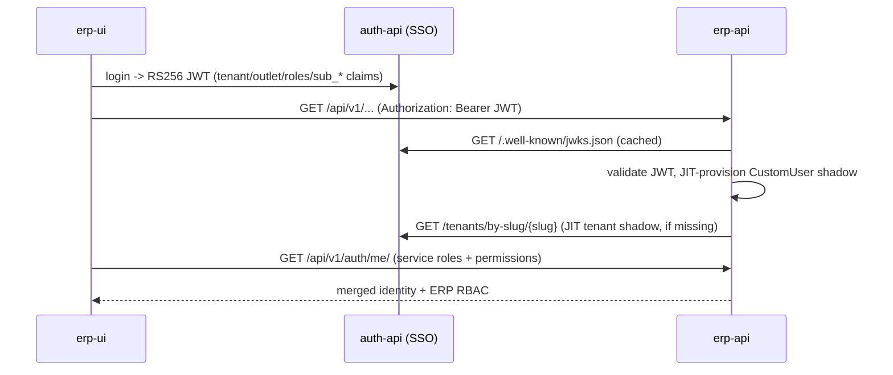
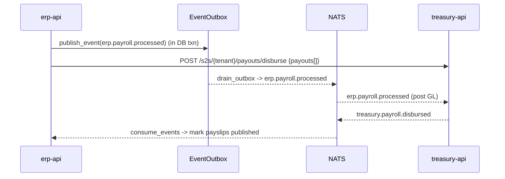

# erp-api Integrations

> Every external interaction of `erp-api`: NATS subjects (pub/sub), S2S HTTP calls
> (inbound + outbound), SSO/OIDC, subscription gating, notifications, treasury payroll/GL,
> exchange-rate API, branding. Authoritative for the Go revamp — keep contracts identical.
> (Supersedes the old pre-decomposition integration guide.)

Go code: `internal/platform/{events,auth,treasury,cache}`, `internal/modules/consumers`,
`internal/services/usersync`, `internal/modules/fx`, shared-auth-client middleware. (The
Django paths below are retained as the contract reference — the Go rebuild keeps the same
subjects + S2S contracts.)

---

## 0. VERIFIED INTEGRATION MAP (authoritative — plan §0a-map, audited across siblings)

ERP's **entire** cross-service surface. ERP consumes ONLY these and owns no other service's
data. ERP = client only for all of them.

- **auth-service (SSO)** — JWT/JWKS validation + `/auth/me` (shared-auth-client). Branding
  read-through `GET /api/v1/tenants/by-slug/{slug}` (auth-api public route), cached 6h via the
  shared `cache` lib (`sharedcache.Aside.GetOrSet`) in `internal/platform/auth.BrandingClient`
  → surfaced on the public branding endpoint.
  Tenant/outlet shadows synced from `auth.tenant.*` / `auth.outlet.created|updated` events; users
  projected into employees from `auth.user.created|updated` (2026-06-15, `modules/consumers/auth_user_sync`).
  Outbound S2S to auth: `GET /api/v1/s2s/{tenant}/users` (one-time employee backfill, `cmd/sync-employees`)
  and `POST /api/v1/s2s/roles/sync` (idempotent service-role registry push from `cmd/seed`).
- **treasury (finance-service)** — payroll disbursement `POST /api/v1/s2s/{tenant}/payouts/disburse`
  (`internal/platform/treasury`, transport via `shared-service-client` with `X-API-Key:
  INTERNAL_SERVICE_KEY` + per-batch `Idempotency-Key`); ERP publishes `erp.payroll.processed` (treasury posts the GL
  journal). **Disbursement is synchronous** — payslips are marked published on the S2S success
  (2026-06-15: the old async `treasury.payroll.disbursed` consumer was removed; treasury actually
  emits `treasury.payout.completed`, and the loop no longer depends on it). **Payroll
  tax stays ERP-owned**; treasury owns GL + payout rails + bank/payment reference.
- **notifications-service** — ERP publishes `erp.email.requested` (supports base64 attachments,
  e.g. payslip PDFs) + `erp.notification.requested` (`internal/platform/events.Notifications`);
  notifications-api consumes both. **ERP never sends email/SMS directly.**
- **subscriptions-service** — feature gating via the tenant subscription endpoint
  (`/api/v1/tenants/{id}/subscription`, Redis-cached), **mutations-only**. Single shared
  `INTERNAL_SERVICE_KEY` for all S2S.
- **NO consumption from inventory / ordering / logistics / marketflow / projects.** Assets →
  inventory+treasury, customers → marketflow, orders/address_book/pickup_station/service_type →
  ordering, projects/tenders → projects-service, banks → treasury/payment-rail reference. ERP
  links to those only via UI menu (external), never their data/schemas.
  - **Employee assets (if ever surfaced):** integrate, don't duplicate. inventory owns assets,
    with `Asset.assigned_to` / `Asset.custodian_id` (user/employee) and `inventory.asset.*` events
    (created/transfer_approved/disposed). ERP would project those events read-only or link to
    inventory-ui — it must NOT define an `EmployeeAssets` schema. (An accidental one was caught +
    removed 2026-06-15.)
- **Tenant-scoped backups (erp-owned, 2026-06-15):** `internal/modules/backup` + `/api/v1/backups`
  export ONLY the requesting tenant's rows — never a platform-wide DB dump. Platform owners scope
  via the `?tenantId=` override (`scopeFromRequest`, gated on `IsPlatformOwner`). See
  memory `feedback_tenant_scoped_backups`.
- **Shared libs (latest tagged releases, plan §0d):**
  - `shared-auth-client v0.9.0` (via `replace … => github.com/Bengo-Hub/auth-client v0.9.0`) — JWKS/Claims/middleware.
  - `shared-events v0.5.0` — outbox `OutboxPoller` + NATS `QueueSubscribe` + `IdempotencyStore`.
  - `httpware v0.5.0` — HTTP middleware stack in `cmd/server/main.go` (RequestID, Logging, Recover, CORS).
  - `cache v0.3.0` — cache-aside helper (`sharedcache.New(redisClient, log)` + `GetOrSet`/`Key`); backs the branding read-through.
  - `shared-service-client v0.3.1` — resilient S2S transport (circuit-breaker + retry + tracing + tenant/request-id propagation); backs the treasury client.
  - `pagination v0.3.0` — uniform list envelope (`data/total/limit/page/hasMore`) for all list endpoints.

---

## 1. Event bus (NATS JetStream + transactional outbox)

### Envelope (`integrations/events.py:_envelope`)
```json
{
  "id": "<uuid>",
  "tenant_id": "<auth-api tenant uuid>",
  "aggregate_type": "erp",
  "aggregate_id": "<batch/object ref>",
  "event_type": "payroll.processed",
  "payload": { },
  "timestamp": "<iso8601>",
  "version": "1.0",
  "source": "erp"
}
```
Subject = `{aggregate_type}.{event_type}` (e.g. `erp.payroll.processed`).
All publishing/consuming gated by `EVENTS_ENABLED`. Drained by `manage.py drain_outbox`,
consumed by `manage.py consume_events`.

### Subjects PUBLISHED by erp-api

| Subject | Emitted by | Payload shape (key fields) | Consumed by |
|---|---|---|---|
| `erp.payroll.processed` | `hrm/payroll/treasury_integration.py:publish_and_disburse` | `{tenant_id, outlet_id, period, currency:"KES", totals:{gross,deductions,net}, lines:[{employee_id, employee_ref, gross, net_pay, statutory:{paye,nhif,nssf,housing}}], cost_center, batch_ref}` | treasury-api (posts GL: DR Salaries & Wages, CR Accrued Salary Payable + statutory liabilities) |
| `erp.email.requested` | `integrations/notifications_client.py:EmailService.send_email` | `{subject, message, recipient_list[], html_message, from_email, cc[], bcc[], reply_to, attachments[{filename,content(base64),mimetype,encoding}]}` | notifications-api |
| `erp.notification.requested` | `integrations/notifications_client.py:NotificationService.send_notification` | `{user_id, email, title, message, notification_type, channels[], data{}, image_url, action_url, email_subject, templates:{email,sms,push}, context{}}` | notifications-api |

> Additional `erp.*` subjects can be emitted by any module via `publish_event(...)`. Payslip emailing
> and payroll notifications both flow through `erp.email.requested` / `erp.notification.requested`.
>
> **Re-verified against the Go code 2026-09-27.** The "only three subjects" note from the Django audit
> is out of date. The Go service also publishes, all consumed by treasury-api:
>
> | Subject | Purpose |
> |---|---|
> | `erp.payroll.reversed` | Reverse a posted payroll journal |
> | `erp.expense_claim.approved` | Post an approved staff claim |
> | `erp.casual_payment.approved` | Post casual labour pay (the name is `casual_payment`, not `casual_labor`) |
> | `erp.consultant_voucher.approved` | Post a consultant voucher with its cost center |
> | `erp.staff_purchase.recovered`, `erp.staff_purchase.recovery_reversed` | Staff purchase recovery through payroll |
>
> Known gaps, in progress under `.claude/plans/budgets-planning-projects-bi-2026-09-27.md`: the
> `erp.payroll.processed` payload hardcodes `"cost_center": ""` (`internal/modules/payroll/event_payload.go`)
> and has no per-project split from `EmployeeProjectAllocation`; `erp.payroll.project_allocations` is
> named in a schema comment but never published; `erp.expense_claim.submitted` and `.rejected` are not
> published yet.

### Subjects CONSUMED by erp-api

Handlers registered into `integrations.events.CONSUMER_HANDLERS` by modules.

| Subject(s) | Handler | Effect |
|---|---|---|
| `auth.tenant.*` (created/updated/…) | `modules/consumers/tenant_sync` | upsert `AuthTenant` shadow |
| `auth.outlet.*` (created/updated/archived) | `modules/consumers/tenant_sync` | upsert/archive `AuthOutlet` shadow |
| `auth.user.created` / `auth.user.updated` | `modules/consumers/auth_user_sync` | project the auth user into an `Employee` keyed on the CustomUser shadow (name/email/outlet); skips platform admins (2026-06-15) |

> **Removed 2026-06-15:** the `treasury.payroll.disbursed` consumer. Treasury emits
> `treasury.payout.completed` (not `…payroll.disbursed`), and the disburse flow now marks
> payslips published synchronously on the S2S success — no async dependency.

> **Gotcha**: `CONSUMER_HANDLERS` is populated lazily by module imports; if a module isn't imported,
> its consumer silently does nothing and `consume_events` warns "No consumer handlers registered".
> (See `gaps-and-bugs.md`.)

---

## 2. Service-to-service (S2S) HTTP

Client: `integrations/service_client.py:ServiceClient` / `get_client(service, request=)`.
- Auth headers: `X-API-Key: INTERNAL_SERVICE_KEY`; forwards caller `Authorization: Bearer <jwt>`
  and `X-Tenant-ID` / `X-Tenant-Slug` / `X-Outlet-ID` from `request.auth_claims`.
- Retry: `urllib3 Retry` total=`SERVICE_CLIENT_RETRIES` (2), backoff 0.3, on 502/503/504.
- Base URLs from `settings.SERVICE_URLS` (auth, treasury, inventory, pos, ordering, notifications,
  marketflow, subscriptions).

### OUTBOUND calls erp-api makes

| Target | Method + Path | Caller | Purpose |
|---|---|---|---|
| auth-api | `GET /api/v1/tenants/by-slug/{slug}` | `tenant_sync.ensure_tenant`, `branding.get_tenant_branding` | resolve tenant UUID + branding (logo/colors/KRA/address) |
| auth-api | `GET /api/v1/tenants/{slug}/outlets` | `tenant_sync.sync_outlets` | list outlets to mirror |
| auth-api | `GET /.well-known/jwks.json` | shared-auth-client | RS256 public keys for JWT validation |
| auth-api | `GET /api/v1/s2s/{tenant}/users` | `cmd/sync-employees` | list a tenant's members to backfill employees (X-API-Key) |
| auth-api | `POST /api/v1/s2s/roles/sync` | `cmd/seed` | idempotently push erp's service-role catalogue to the auth registry (X-API-Key) |
| treasury-api | `GET /api/v1/s2s/{tenant}/taxes` | `integrations/taxes.py:get_tax_codes` | tenant tax codes (cached 1h) |
| treasury-api | `GET /api/v1/s2s/{tenant}/taxes/{code}` | `integrations/taxes.py:get_tax_code` | single tax code |
| treasury-api | `POST /api/v1/s2s/{tenant}/payouts/disburse` | `hrm/payroll/treasury_integration.py:publish_and_disburse` | disburse net pay; body `{payouts:[{recipient_id, amount, currency:"KES", payment_method:"bank_transfer", reference_id, description}]}` |

### INBOUND endpoints other services call on erp-api

erp-api currently exposes NO dedicated `/api/v1/s2s/...` surface (HR data is not consumed S2S by
others as of audit). Inbound integration is event-driven (`auth.*`, `treasury.payroll.disbursed`).
Public/health endpoints:

| Path | Auth | Purpose |
|---|---|---|
| `GET /api/v1/core/health/` | none | liveness/readiness (Docker/k8s) |
| `GET /api/v1/integrations/health/` | none | integration subsystem health |
| `GET /api/v1/business/public-branding/` | none | public branding for login page |
| `GET /api/v1/auth/me/` | JWT | service RBAC profile (Trinity two-step) |

> Revamp note: if other services later need HR data (e.g. employee directory), add a versioned
> `/api/v1/s2s/{tenant}/...` surface guarded by `INTERNAL_SERVICE_KEY` (httpware API-key auth).

#### External expense claims (added 2026-10-10)

Other services raise employee claims here instead of keeping their own allowance logic. First
caller: logistics-api, for staff (salaried) riders' per diem.

| Path | Auth | Purpose |
|---|---|---|
| `POST /api/v1/hrm/claims/external` | X-API-Key + X-Tenant-ID, or JWT with `hrm.payroll.manage` | Raise a claim for the employee whose auth user id is given. Idempotent on `source_key` (201 created, 200 existing). |
| `GET /api/v1/hrm/claims/external?source_key=` | same | Status of the claim raised for a key. |
| `GET\|PUT /api/v1/hrm/payroll/per-diem-policy` | JWT `hrm.payroll.view` / `hrm.payroll.manage` (services may read) | Tenant per diem policy, AppSetting `hrm.per_diem_policy`. |

Body: `auth_user_id`, `source`, `source_key`, `claim_type` (`per_diem` default, `reimbursement`,
`other`), `days` (0 derives whole days from `started_at`/`ended_at`), `distance_km`, `amount`
(non per diem only), `description`, `reference` (caller ids). For `per_diem` the amount is
`days x rate`, where rate is the employee's job group rate (from salary details) or the policy's
`daily_rate`; `max_days` caps days; trips shorter than `min_distance_km` are refused. The claim
is an ordinary `expense_claims` row (`claim_type = per_diem`, `metadata.source/source_key/...`)
that goes through approval, KRA per diem caps, payroll scheduling and reimbursement like any
other. 422 codes: `not_an_employee`, `per_diem_disabled` (policy off or no rate), `not_eligible`.
The policy is disabled until HR saves a rate.

---

## 3. SSO / OIDC (auth-api as IdP)

- `SSO_ENABLED` gates the whole flow. `authmanagement/sso.py`:
  - `validate_token(jwt)` → JWKS RS256, requires `exp`+`sub`, optional `aud`/`iss`, leeway
    `AUTH_JWT_LEEWAY` (30s). JWKS cached `AUTH_JWKS_TTL` (600s).
  - `Claims` wrapper exposes: `sub, email, first/last_name, tenant_id, tenant_slug, outlet_id,
    outlet_code, outlet_use_case, is_hq_user, roles[], permissions[], is_platform_owner,
    is_superuser, sub_status, sub_features[], sub_limits{}, sub_expires, billing_mode, is_demo`.
  - `get_or_provision_user(claims)` JIT-creates/links `CustomUser` by `external_id` then email;
    sets unusable password; mirrors superuser/platform flags; assigns service roles
    (`_assign_service_roles`: 1:1 name match to ERP groups, else generic fallback, else `staff`).
- Middleware (`authmanagement/sso_middleware.py`):
  - `SSOAuthenticationMiddleware` → `request.auth_claims`.
  - `TenantOutletContextMiddleware` → `request.tenant_id` (platform-owner `?tenantId=` override),
    `request.outlet_id`, JIT tenant/outlet shadow sync.
- **Gotchas** (carry into Go): GET requests should not be blocked when claims are missing (public
  routes); the OIDC token-endpoint / GET-auth-skip behavior is the documented source of spurious
  401/403 in sibling services.

### SSO login sequence



---

## 4. Subscription gating

- `authmanagement/sso_middleware.py:SubscriptionGatingMiddleware` (gated by
  `SUBSCRIPTION_GATING_ENABLED`).
- **Mutations only**: GET/HEAD/OPTIONS/TRACE always pass. Exempt prefixes: `/health`,
  `/api/v1/auth/`, `/api/v1/webhooks/`, `/swagger`, `/redoc`, `/static/`, `/media/`.
- Pass if `is_superuser || is_platform_owner || claims.is_subscription_active()`.
  `is_subscription_active()`: `billing_mode=="service_charge"` or `is_demo` → always active;
  absent `sub_status` → active (non-gated tenants); else `sub_status ∈ {ACTIVE,TRIAL,TRIALING}`.
- Block → `403 {error, code:"subscription_inactive", upgrade:true}`.
- Feature checks: `claims.has_feature(code)` against `sub_features` baked into JWT by auth-api.

---

## 5. Notifications (notifications-api via events)

The ERP owns no templates/providers. `integrations/notifications_client.py` provides drop-in
`EmailService` / `NotificationService` that publish `erp.email.requested` /
`erp.notification.requested`. Attachments are base64-normalized. Best-effort; never raises on
transport problems (durably enqueued in the outbox).

---

## 6. Treasury (payroll GL + disbursement)

`hrm/payroll/treasury_integration.py`. On payroll finalisation:
1. `publish_event("payroll.processed", event, aggregate_id=batch_ref, tenant_id=...)` →
   treasury posts the GL journal (DR Salaries & Wages; CR Accrued Salary Payable + PAYE/NHIF/NSSF/
   Housing-Levy liabilities).
2. `POST /api/v1/s2s/{tenant}/payouts/disburse` with per-employee net-pay payouts (best-effort;
   transport failure does not roll back the GL event — treasury reconciles).
3. Consume `treasury.payroll.disbursed` → mark payslips `published`.

Treasury is the single source of truth for money + GL; the ERP never posts ledgers or moves cash.

### Payroll → treasury sequence



---

## 7. Exchange-rate API (FX)

- Config model `integrations/models.py:ExchangeRateAPISettings` (provider, endpoint, **encrypted**
  `access_key` via `integrations/utils.py:Crypto`/Fernet, source + target currencies, schedule).
- Celery Beat task `integrations/tasks.py:fetch_exchange_rates` runs daily 00:00; writes
  `core.ExchangeRate` rows (forward + reverse pairs, `source="api"`). Manual trigger:
  `manual_fetch_exchange_rates`. Default provider `exchangerate.host` (`/live` quotes format).
- This is the only finance-adjacent config the ERP retains (HR/ops currency normalisation).

---

## 8. Branding & taxes (read-through caches)

- `integrations/branding.py:get_tenant_branding(slug)` — fetches auth-api `GET /tenants/by-slug/{slug}`,
  caches 6h. Returns `{name, slug, logo_url, primary_color, secondary_color, kra_pin, address}`.
  The ERP must NOT own a branding editor (auth-api is SoT). Used by document/payslip PDFs + login.
- `integrations/taxes.py` — treasury is SoT for sales tax; cached 1h. (Payroll statutory deductions
  are computed locally — NOT fetched here.)

---

## 9. Contract summary tables

### All event subjects
| Subject | Direction | Counterparty |
|---|---|---|
| `erp.payroll.processed` | OUT | treasury-api |
| `erp.email.requested` | OUT | notifications-api |
| `erp.notification.requested` | OUT | notifications-api |
| `auth.tenant.*` | IN | auth-api |
| `auth.outlet.*` | IN | auth-api |
| `auth.user.created` / `auth.user.updated` | IN | auth-api (→ employee projection) |

### All S2S HTTP contracts
| Direction | Service | Method Path |
|---|---|---|
| OUT | auth-api | `GET /api/v1/tenants/by-slug/{slug}` |
| OUT | auth-api | `GET /api/v1/tenants/{slug}/outlets` |
| OUT | auth-api | `GET /.well-known/jwks.json` |
| OUT | auth-api | `GET /api/v1/s2s/{tenant}/users` (employee backfill) |
| OUT | auth-api | `POST /api/v1/s2s/roles/sync` (service-role registry) |
| OUT | treasury-api | `GET /api/v1/s2s/{tenant}/taxes` |
| OUT | treasury-api | `GET /api/v1/s2s/{tenant}/taxes/{code}` |
| OUT | treasury-api | `POST /api/v1/s2s/{tenant}/payouts/disburse` |
| IN | logistics-api | `POST /api/v1/hrm/claims/external` (staff rider per diem) |
| IN | (k8s/UI) | `GET /api/v1/core/health/`, `GET /api/v1/integrations/health/`, `GET /api/v1/business/public-branding/`, `GET /api/v1/auth/me/` |

---

## 10. Go revamp mapping

| Django piece | Go replacement |
|---|---|
| `integrations/events.py` + `EventOutbox` + `drain_outbox`/`consume_events` | `shared-events` `OutboxPoller` + NATS consumers in `modules/consumers` against an `outbox_events` Ent table |
| `integrations/service_client.py` | `platform/auth`, `platform/treasury` typed S2S clients (treasury over `shared-service-client v0.3.1` + `INTERNAL_SERVICE_KEY`) |
| `authmanagement/sso.py` + middleware | `shared-auth-client` (JWKS, Claims, middleware) + `services/usersync` JIT shadow |
| `SubscriptionGatingMiddleware` | `platform/subscriptions` middleware (claims-based, mutations-only) — copy inventory-api |
| `integrations/branding.py` / `taxes.py` | `platform/auth.GetBranding` / `platform/treasury.GetTaxCodes` (Redis-cached) |
| `notifications_client.py` | thin `platform/notifications` publisher (`erp.email.requested` / `erp.notification.requested`) |
| `integrations/tasks.fetch_exchange_rates` (Celery Beat) | cron goroutine / k8s CronJob calling `platform/fx` |
| `treasury_integration.py` | `modules/payroll` finalize step → publish + S2S disburse + consumer |

Keep subjects, payload shapes, and S2S paths byte-compatible so downstream services need no change.
