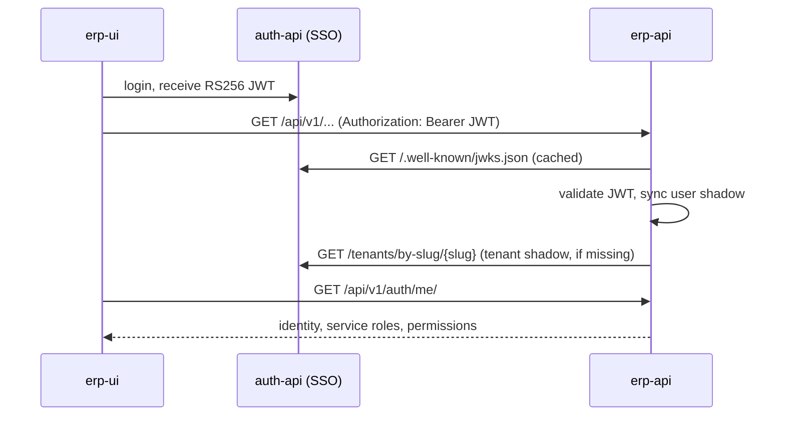
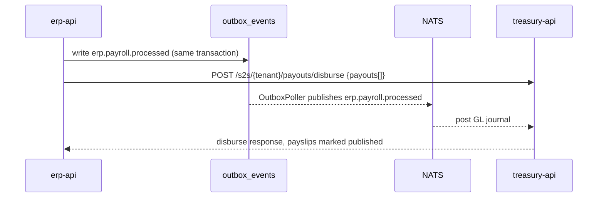

# erp-api Integrations

> Every external interaction of `erp-api`: NATS subjects (pub/sub), S2S HTTP calls
> (inbound + outbound), SSO/OIDC, subscription gating, notifications, treasury payroll/GL,
> exchange-rate API, branding. Keep these contracts stable; other services depend on them.

Go code: `internal/platform/{events,auth,treasury,cache}`, `internal/modules/consumers`,
`internal/services/usersync`, `internal/modules/fx`, shared-auth-client middleware.

---

## 0. VERIFIED INTEGRATION MAP (authoritative — plan §0a-map, audited across siblings)

ERP's **entire** cross-service surface. ERP consumes ONLY these and owns no other service's
data. ERP = client only for all of them.

- **auth-service (SSO)** — JWT/JWKS validation + `/auth/me` (shared-auth-client). Branding
  read-through `GET /api/v1/tenants/by-slug/{slug}` (auth-api public route), cached 6h via the
  shared `cache` lib (`sharedcache.Aside.GetOrSet`) in `internal/platform/auth.BrandingClient`
  → surfaced on the public branding endpoint.
  Tenant/outlet shadows synced from `auth.tenant.*` / `auth.outlet.created|updated` events; users
  projected into employees from `auth.user.created|updated` (2026-06-15, `modules/consumers/auth_user_sync`).
  Outbound S2S to auth: `GET /api/v1/s2s/{tenant}/users` (one-time employee backfill, `cmd/sync-employees`)
  and `POST /api/v1/s2s/roles/sync` (idempotent service-role registry push from `cmd/seed`).
- **treasury (finance-service)** — payroll disbursement `POST /api/v1/s2s/{tenant}/payouts/disburse`
  (`internal/platform/treasury`, transport via `shared-service-client` with `X-API-Key:
  INTERNAL_SERVICE_KEY` + per-batch `Idempotency-Key`); ERP publishes `erp.payroll.processed` (treasury posts the GL
  journal). **Disbursement is synchronous** — payslips are marked published on the S2S success
  (2026-06-15: the old async `treasury.payroll.disbursed` consumer was removed; treasury actually
  emits `treasury.payout.completed`, and the loop no longer depends on it). **Payroll
  tax stays ERP-owned**; treasury owns GL + payout rails + bank/payment reference.
- **notifications-service** — ERP publishes `erp.email.requested` (supports base64 attachments,
  e.g. payslip PDFs) + `erp.notification.requested` (`internal/platform/events.Notifications`);
  notifications-api consumes both. **ERP never sends email/SMS directly.**
- **subscriptions-service** — feature gating via the tenant subscription endpoint
  (`/api/v1/tenants/{id}/subscription`, Redis-cached), **mutations-only**. Single shared
  `INTERNAL_SERVICE_KEY` for all S2S.
- **NO consumption from inventory / ordering / logistics / marketflow / projects.** Assets →
  inventory+treasury, customers → marketflow, orders/address_book/pickup_station/service_type →
  ordering, projects/tenders → projects-service, banks → treasury/payment-rail reference. ERP
  links to those only via UI menu (external), never their data/schemas.
  - **Employee assets (if ever surfaced):** integrate, don't duplicate. inventory owns assets,
    with `Asset.assigned_to` / `Asset.custodian_id` (user/employee) and `inventory.asset.*` events
    (created/transfer_approved/disposed). ERP would project those events read-only or link to
    inventory-ui — it must NOT define an `EmployeeAssets` schema. (An accidental one was caught +
    removed 2026-06-15.)
- **Tenant-scoped backups (erp-owned, 2026-06-15):** `internal/modules/backup` + `/api/v1/backups`
  export ONLY the requesting tenant's rows — never a platform-wide DB dump. Platform owners scope
  via the `?tenantId=` override (`scopeFromRequest`, gated on `IsPlatformOwner`). See
  memory `feedback_tenant_scoped_backups`.
- **Shared libs (latest tagged releases, plan §0d):**
  - `shared-auth-client v0.9.0` (via `replace … => github.com/Bengo-Hub/auth-client v0.9.0`) — JWKS/Claims/middleware.
  - `shared-events v0.5.0` — outbox `OutboxPoller` + NATS `QueueSubscribe` + `IdempotencyStore`.
  - `httpware v0.5.0` — HTTP middleware stack in `cmd/server/main.go` (RequestID, Logging, Recover, CORS).
  - `cache v0.3.0` — cache-aside helper (`sharedcache.New(redisClient, log)` + `GetOrSet`/`Key`); backs the branding read-through.
  - `shared-service-client v0.3.1` — resilient S2S transport (circuit-breaker + retry + tracing + tenant/request-id propagation); backs the treasury client.
  - `pagination v0.3.0` — uniform list envelope (`data/total/limit/page/hasMore`) for all list endpoints.

---

## 1. Event bus (NATS JetStream + transactional outbox)

### Envelope
```json
{
  "id": "<uuid>",
  "tenant_id": "<auth-api tenant uuid>",
  "aggregate_type": "erp",
  "aggregate_id": "<batch/object ref>",
  "event_type": "payroll.processed",
  "payload": { },
  "timestamp": "<iso8601>",
  "version": "1.0",
  "source": "erp"
}
```
Subject = `{aggregate_type}.{event_type}` (for example `erp.payroll.processed`). Domain code calls
`platform/events.Publisher.Publish`, which writes an `outbox_events` row in the same transaction; the
`shared-events` `OutboxPoller` publishes it. Everything is gated by `EVENTS_ENABLED`.

### Subjects published by erp-api

| Subject | Emitted by | Consumed by |
|---|---|---|
| `erp.payroll.processed` | `modules/payroll/event_payload.go` on finalisation | treasury-api (posts the GL journal: DR Salaries and Wages, CR Accrued Salary Payable and statutory liabilities) |
| `erp.payroll.reversed` | payroll reversal | treasury-api |
| `erp.expense_claim.created`, `.updated`, `.approved`, `.deleted` | `modules/payroll/claim_events.go` | treasury-api (budget commitment, then reimbursement) |
| `erp.casual_payment.approved` | casual labour approval | treasury-api |
| `erp.consultant_voucher.approved` | consultant voucher approval | treasury-api |
| `erp.staff_purchase.recovered`, `.recovery_reversed` | staff purchase recovery through payroll | treasury-api |
| `erp.employee.upserted` | staff purchase flow (`modules/staffpurchase`) | other services that mirror employees |
| `erp.email.requested` | `platform/events` notifications publisher | notifications-api |
| `erp.notification.requested` | `platform/events` notifications publisher | notifications-api |

`erp.email.requested` payload: `{subject, message, recipient_list[], html_message, from_email, cc[], bcc[],
reply_to, attachments[{filename, content(base64), mimetype, encoding}]}`.
`erp.notification.requested` payload: `{user_id, email, title, message, notification_type, channels[],
data{}, image_url, action_url, email_subject, templates, context}`.

`erp.payroll.processed` payload: `{tenant_id, outlet_id, period, currency, totals:{gross, deductions, net},
lines:[{employee_id, employee_ref, gross, net_pay, statutory:{paye, nhif, nssf, housing}}], cost_center,
allocations[], batch_ref}`. Money is sent as decimal strings. `cost_center` and `allocations[]` come
from each employee's project allocations and department cost centre.

### Subjects consumed by erp-api

| Subject | Handler | Effect |
|---|---|---|
| `auth.tenant.*` | `modules/consumers/tenant_sync` | upsert the tenant shadow |
| `auth.outlet.*` | `modules/consumers/tenant_sync` | upsert or archive the outlet shadow |
| `auth.user.created`, `.updated`, `.deleted` | `modules/consumers/auth_user_sync` | project the auth user into an employee (name, email, outlet); skips platform admins |

Treasury's payout completion event is not consumed: the disburse flow marks payslips published
synchronously when the S2S call succeeds.

---

## 2. Service to service HTTP

Transport is `shared-service-client` (retry, circuit breaker, tracing, tenant and request id
propagation). Auth header `X-API-Key: INTERNAL_SERVICE_KEY`, plus `X-Tenant-ID` where the call is
tenant-scoped. Base URLs come from `internal/config/config.go`.

### Outbound calls

| Target | Method and path | Code | Purpose |
|---|---|---|---|
| auth-api | `GET /api/v1/tenants/by-slug/{slug}` | `platform/auth/branding.go`, `services/usersync` | tenant id and branding (cached 6h) |
| auth-api | `GET /api/v1/tenants/{slug}/outlets` | `services/usersync` | outlets to mirror |
| auth-api | `GET /.well-known/jwks.json` | `shared-auth-client` | RS256 public keys |
| auth-api | `GET /api/v1/s2s/{tenant}/users` | `cmd/sync-employees` | one-time employee backfill |
| auth-api | `POST /api/v1/s2s/roles/sync` | `cmd/seed` | idempotent push of the service role catalogue |
| treasury-api | `GET /api/v1/s2s/{tenant}/taxes`, `.../taxes/{code}` | `platform/treasury` | sales tax codes (not used for payroll) |
| treasury-api | `POST /api/v1/s2s/{tenant}/payouts/disburse` | `platform/treasury`, `modules/payroll` | disburse net pay; per-batch `Idempotency-Key`; body `{payouts:[{recipient_id, amount, currency, payment_method, reference_id, description}]}` |
| treasury-api | `POST /api/v1/s2s/{tenant}/budgets/claim-check` | `platform/treasury` | budget check before a claim is approved |
| subscriptions-api | `GET /api/v1/tenants/{id}/subscription` | `platform/subscriptions` | feature entitlement |
| projects-api | project lookups | `platform/lookups` | project names for pickers and cost splits |

### Inbound endpoints

erp-api has no dedicated `/api/v1/s2s/...` surface; other services integrate through events. If another
service needs HR data, add a versioned `/api/v1/s2s/{tenant}/...` surface guarded by `INTERNAL_SERVICE_KEY`.

| Path | Auth | Purpose |
|---|---|---|
| `GET /healthz`, `GET /readyz` | none | liveness and readiness |
| `GET /metrics` | none | Prometheus |
| `GET /api/v1/business/public-branding/` | none | branding for the login page |
| `GET /api/v1/auth/me/` | JWT | service roles and permissions |

#### Employee lookup for pickers (added 2026-10-16)

`GET /api/v1/hrm/employees/lookup?q=&limit=` returns `{data: [{id, employee_number, name, email}]}`:
the tenant's active employees (not deleted, not terminated) whose name, staff number or email
contains `q`, by name, at most 50. Nothing else about the employee leaves erp. A service calls it
with `X-API-Key` and `X-Tenant-ID` (the same tenant resolution as the staff-purchase endpoints); a
signed-in user needs employee view and sees only their tenant. A service key passes erp's own plan
gate, so the caller checks the tenant's plan first: maskani-api only calls it when the tenant has
the ERP `hr_management` feature (its work order staff picker).

#### Timesheets for projects-api (project hours 2026-09-28, time logging 2026-11-16)

projects-api reads project hours for utilisation and earned value, and logs its users' time (task
timer and week grid) into their ERP timesheets. ERP owns the hours; projects-api stores none.

| Path | Auth | Purpose |
|---|---|---|
| `GET /api/v1/hrm/attendance/timesheets/project-hours?project_ids=&from=&to=` | X-API-Key + X-Tenant-ID, or JWT `hrm.attendance.view` | `{data:[{project_id, approved_hours, submitted_hours, labour_cost, unbilled_billable_hours}]}`, decimal strings; `labour_cost` is the approved hours times each employee's salary details `hourly_rate` (0 without one), `unbilled_billable_hours` the approved, billable hours no billing run has reserved |
| `POST /api/v1/hrm/attendance/timesheets/billing/reserve` | X-API-Key + X-Tenant-ID only | body `{project_id, from, to, billing_ref}`; reserves the approved, billable entries of the project dated from to to (inclusive, at most 366 days) that carry no `billing_ref`, then answers every entry carrying this `billing_ref`: `{data:[{id, date, task_id, employee_id, employee_name, hours, description}], billed_invoice_id}` |
| `POST /api/v1/hrm/attendance/timesheets/billing/confirm` | same | body `{billing_ref, invoice_id}`; sets `billed_invoice_id` on every entry with the ref, replacing an earlier one; `{updated: n}` |
| `POST /api/v1/hrm/attendance/timesheets/billing/release` | same | body `{billing_ref, include_confirmed}`; clears the ref from entries not yet confirmed, or with `include_confirmed: true` from every entry with the ref and their `billed_invoice_id` too; `{released: n}` |
| `GET /api/v1/hrm/attendance/timesheets/for-user?auth_user_id=&from=&to=` | X-API-Key + X-Tenant-ID, or the employee's own JWT | `{employee_id, timesheets:[...], entries:[...]}`: the employee's timesheets overlapping the range and their entries in it |
| `POST /api/v1/hrm/attendance/timesheets/for-user/entries` | same | set or add hours on one entry; body below |
| `POST /api/v1/hrm/attendance/timesheets/for-user/submit` | same | `{auth_user_id, from, to}`: submit every draft or rejected timesheet overlapping the range; `{data:[timesheet]}` |

Entry body: `auth_user_id`, `period_start`, `period_end` (the period to open as a draft when no
timesheet covers `date`; projects-api sends the Monday to Sunday week), `date`, `project_id`,
`task_id` (needs a project), `billable` (omitted keeps the stored flag), `task_description`
(empty keeps it), `regular_hours` (decimal string), `mode` (`set`, the default, or `add` for a
stopped timer). It answers `{employee_id, timesheet, entry}`. An entry is one per date, project
and task, at most 24 hours. It is a POST so the shared client never retries an `add` twice.

Errors: 404 `no_employee_record` (the auth user has no employee in the tenant; HR adds them),
409 `timesheet_locked` (the covering timesheet is submitted or approved), 409 `nothing_to_submit`,
400 `invalid_entry`. The employee is found by the auth user id through `custom_users.external_id`
(the ESS `?mine=true` resolver). A service key carries no plan features, so projects-api checks
the user's token for ERP's `attendance` feature before it calls; a signed-in employee calling for
themselves is checked here and gets the standard `feature_not_available` 403. Approval and
rejection stay in ERP's own timesheet screens.

Billing project time: projects-api picks a `billing_ref` for an invoice run, reserves the entries,
creates the treasury invoice and confirms the ref with the invoice id. When the invoice cannot be
created it releases the ref; when treasury later shows the invoice void or cancelled it releases
with `include_confirmed: true`, so the time can be billed again. A retry with the same ref answers
the entries the earlier attempt reserved, and `billed_invoice_id` tells it the run was already
confirmed. Both keys live in `timesheet_entries.metadata`. The reservation is one `UPDATE`, so two
runs at once never reserve the same entry. A user token gets 403 on these routes; time is billed
only through projects-api.

`PUT /api/v1/hrm/attendance/timesheets/{id}/entries` (ERP's own screens) takes the same
`task_id` and `billable` and keys entries the same way, so two projects on one day are two rows.

#### Capacity for projects-api workload (2026-11-17)

ERP now holds each person's working hours, so projects-api's workload reads capacity from here
instead of its own tenant setting. HR gives an employee a standard work shift
(`PUT /api/v1/hrm/employees/{id}` with `work_shift_id`, `""` clears it; it must be one of the
tenant's shifts). The shift's `total_hours_per_week` is spread evenly over its working days (its
schedule's working days, Monday to Friday without a schedule); a shift with no total uses its
schedule's own hours (end minus start minus break, past midnight for a night shift).

`GET /api/v1/hrm/attendance/capacity?auth_user_ids=a,b&from=YYYY-MM-DD&to=YYYY-MM-DD`, X-API-Key
plus X-Tenant-ID (or a JWT with `hrm.attendance.view`), at most 500 ids and 366 days, answers

```json
{"data": [{"auth_user_id": "...", "has_employee": true, "configured": true, "work_shift": "Office",
  "weekly_hours": "40", "weeks": [{"week_start": "2026-11-16", "hours": "16", "leave_hours": "16", "holiday_hours": "8",
  "pending_leave_hours": "0"}]}]}
```

one row per id in the order asked, with every ISO week from the Monday of `from` to the week
holding `to` (whole weeks). `hours` is the weekly hours minus approved leave and the public
holidays on working days that apply to the person: the tenant's national holidays plus those of
their county (a non-national holiday's `county` matched, in any case, against the name or code of
the employee's HR region, `hr_details.region_id`, or of that region's parent). A day that is both
leave and holiday counts once as holiday, and a leave request whose `days_requested` is below its
working days (a half day) takes that share of each day. `pending_leave_hours` is leave still
waiting for approval on the part of a working day not already off; it is reported for planning and
not taken off `hours`.
`has_employee` is false when the user has no live employee in the tenant (found through
`custom_users.external_id`, terminated and deleted employees left out); `configured` is false when
the employee has no shift with hours, and then `weekly_hours` is `"0"` and `weeks` is empty, so
the caller falls back to its own setting for that person. Hours are decimal strings. The read is
at most nine batched queries (users, employees, shifts, schedules, leave, HR details, regions, their
parents, holidays) whatever the number of people. The roster planner's day overrides do not count
yet.

#### External expense claims (added 2026-10-10)

Other services raise employee claims here instead of keeping their own allowance logic. First
caller: logistics-api, for staff (salaried) riders' per diem.

| Path | Auth | Purpose |
|---|---|---|
| `POST /api/v1/hrm/claims/external` | X-API-Key + X-Tenant-ID, or JWT with `hrm.payroll.manage` | Raise a claim for the employee whose auth user id is given. Idempotent on `source_key` (201 created, 200 existing). |
| `GET /api/v1/hrm/claims/external?source_key=` | same | Status of the claim raised for a key. |
| `GET\|PUT /api/v1/hrm/payroll/per-diem-policy` | JWT `hrm.payroll.view` / `hrm.payroll.manage` (services may read) | Tenant per diem policy, AppSetting `hrm.per_diem_policy`. |

Body: `auth_user_id`, `source`, `source_key`, `claim_type` (`per_diem` default, `reimbursement`,
`other`), `days` (0 derives whole days from `started_at`/`ended_at`), `distance_km`, `amount`
(non per diem only), `description`, `reference` (caller ids). For `per_diem` the amount is
`days x rate`, where rate is the employee's job group rate (from salary details) or the policy's
`daily_rate`; `max_days` caps days; trips shorter than `min_distance_km` are refused. The claim
is an ordinary `expense_claims` row (`claim_type = per_diem`, `metadata.source/source_key/...`)
that goes through approval, KRA per diem caps, payroll scheduling and reimbursement like any
other. 422 codes: `not_an_employee`, `per_diem_disabled` (policy off or no rate), `not_eligible`.
The policy is disabled until HR saves a rate (erp-ui Settings, Payroll, Per diem). The claims list
returns `source` and `source_details` (days, daily rate, distance, trip window, caller reference)
for these claims, so HR sees the trip behind each logistics per diem.

---

## 3. SSO (auth-api as identity provider)

`shared-auth-client` validates the RS256 JWT against auth-api's JWKS (`AUTH_JWKS_URL`, issuer and
audience from `AUTH_*`). The claims carry the user, tenant, outlet, roles and permissions, and the
platform owner and superuser flags. `services/usersync` mirrors the user, tenant and outlet on demand.
`modules/rbac` turns the claims into the service roles and permission codes returned by `/auth/me`.
The platform owner may override the tenant with `?tenantId=`.



---

## 4. Subscription gating

`platform/subscriptions` asks subscriptions-api for the tenant's entitlements
(`GET /api/v1/tenants/{id}/subscription`), cached for 60 seconds. Demo and `service_charge` tenants
are exempt. A lookup failure fails open so a paying tenant is never blocked by an outage there.
Plan-gated features (for example staff purchase funded from salary) call `HasFeature` and answer
`403 feature_not_available` when the plan lacks it.

---

## 5. Notifications

The ERP owns no templates or providers. It publishes `erp.email.requested` and
`erp.notification.requested` (attachments base64-encoded) and notifications-api delivers them.
Publishing is durable through the outbox, so a transport problem never fails the caller.

---

## 6. Treasury (payroll GL and disbursement)

On payroll finalisation, in `modules/payroll`:
1. Publish `erp.payroll.processed` through the outbox; treasury posts the GL journal.
2. `POST /api/v1/s2s/{tenant}/payouts/disburse` with per-employee net pay and an `Idempotency-Key`
   per batch, so a repeated request cannot pay twice.
3. On success, mark the payslips published.

Treasury is the single source of truth for money and the ledger; the ERP never posts ledgers or moves cash.
Claim approval also calls treasury's budget `claim-check`; a stop answers `409 over_budget`, and holders of
`approvals.decide` can approve with an override.

**Running payroll (Go, 2026-10-15).** `POST /hrm/payroll/process-with-formulas` queues a
`PayrollRunJob` and answers 202 at once; the pod that took it computes the payslips in the
background. erp-ui follows `GET /hrm/payroll/runs/{id}/events` (Server-Sent Events, read with
fetch so the Authorization header is sent; each connection lasts 15s and the client reconnects
until a `done` event). One active run per tenant (409 `run_in_progress` names it). Approved
attendance deductions are taken off gross before statutory deductions and PAYE, so the gross on
`erp.payroll.processed` is already net of them.



---

## 7. Exchange rates

`modules/fx` stores the provider settings (`ExchangeRateAPISettings`, the access key kept out of the
database) and runs a scheduled fetch every `FX_FETCH_INTERVAL` (default 24h) that writes `ExchangeRate`
rows for the forward and reverse pairs. This is the only finance-adjacent configuration the ERP keeps
(currency normalisation for HR and ops).

---

## 8. Branding and tax codes

- Branding: `platform/auth.BrandingClient` reads auth-api `GET /tenants/by-slug/{slug}` through the
  shared cache (6h) and returns `{name, slug, logo_url, primary_color, secondary_color, kra_pin, address}`.
  The ERP has no branding editor; auth-api owns it. It feeds payslip and report PDFs and the login page.
- Tax codes: treasury owns sales tax. Payroll statutory deductions are computed locally by
  `payrollengine` and never fetched from treasury.

---

## 9. Contract summary

### Event subjects
| Subject | Direction | Counterparty |
|---|---|---|
| `erp.payroll.processed`, `erp.payroll.reversed` | OUT | treasury-api |
| `erp.expense_claim.*`, `erp.casual_payment.approved`, `erp.consultant_voucher.approved`, `erp.staff_purchase.*` | OUT | treasury-api |
| `erp.email.requested`, `erp.notification.requested` | OUT | notifications-api |
| `auth.tenant.*`, `auth.outlet.*` | IN | auth-api |
| `auth.user.created`, `.updated`, `.deleted` | IN | auth-api (employee projection) |

### Inbound HTTP callers
| Caller | Path | Purpose |
|---|---|---|
| logistics-api | `POST /api/v1/hrm/claims/external` | staff rider per diem claims |
| maskani-api | `GET /api/v1/hrm/employees/lookup` | staff picker for work orders |
| projects-api | `GET /api/v1/hrm/attendance/timesheets/project-hours` | project utilisation, earned value, labour cost and unbilled time |
| projects-api | `POST /api/v1/hrm/attendance/timesheets/billing/reserve\|confirm\|release` | bills approved project time on a treasury invoice, once |
| projects-api | `GET\|POST /api/v1/hrm/attendance/timesheets/for-user[/entries\|/submit]` | timer, week grid and submit for the signed-in user |
| projects-api | `GET /api/v1/hrm/attendance/capacity` | workload capacity per person and week (work shift minus leave and holidays) |

Keep subjects, payload shapes and S2S paths stable so downstream services need no change.
