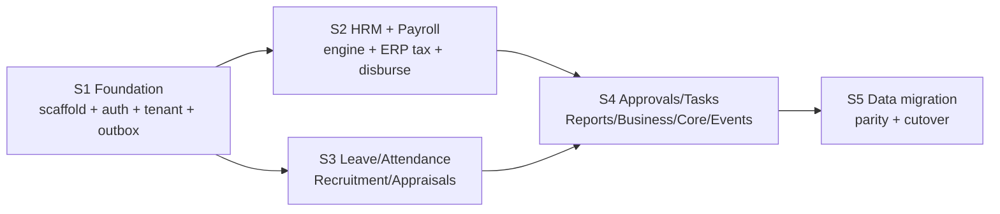

# erp-api Django → Go Revamp Plan

> Executive plan for rebuilding `erp-api` (the HR + internal-ops service) from Django 5 / Python
> to **Go 1.26+**, matching the platform Go services (`inventory-service`, `marketflow`,
> `treasury-api`). Companion docs: `architecture.md` (current + target), `integrations.md`
> (contracts to keep identical), `erd.md` (schema), `data-migration.md` (prod ETL),
> `gaps-and-bugs.md` (what we're fixing), `sprints/` (execution).

---

## 1. Why rebuild (rationale)

1. **Performance & footprint.** The Django service drags a 200-line `requirements.txt` (Stripe,
   Twilio, Firebase, OpenAI, scikit/scipy, Celery, Channels/Daphne, jazzmin, …), per-request
   "ensure config exists" middlewares, and synchronous DRF viewsets. Go gives an order-of-magnitude
   smaller image, lower latency, and goroutine concurrency for the outbox/consumers.
2. **Shared-library reuse.** Every other BengoBox service is Go and reuses
   `shared-auth-client`, `httpware`, `shared-events`, `cache`, `shared-service-client`,
   Ent + Atlas. The Django ERP reimplements all of these by hand (`integrations/service_client.py`,
   `integrations/events.py`, `authmanagement/sso.py`) — duplicate, drifting, and untested against the
   canonical contracts. Going Go deletes that bespoke surface.
3. **Correctness & security debt.** `gaps-and-bugs.md` documents no tenant isolation at the
   query/permission layer (P0), money handled as `float` into the disbursement path (P0), payroll
   that silently returns 0 on misconfig (P0), global (non-tenant) tax rate tables (P0), committed
   secrets (P0), and broad dead code from the platform decomposition. A rebuild on the platform Go
   patterns fixes these by construction (mandatory `tenant_id`, `decimal`, errors-not-zeros).
4. **Consistency.** One language, one ORM, one migration tool, one auth/event stack across the
   platform → lower cognitive load, shared CI, shared on-call runbooks.

**Non-goals.** We do NOT re-introduce any decomposed domain (finance/pos/order/product/stock/
procurement/manufacturing/crm/notifications/assets). Those stay in their owner services and are
reached only via S2S/events. We do NOT change external contracts (event subjects, payload shapes,
S2S paths) — downstream services must require zero changes.

---

## 2. Target stack

| Concern | Choice (matches platform) |
|---|---|
| Language | Go 1.26+ |
| HTTP | `chi` router wrapped by `github.com/Bengo-Hub/httpware` (CORS, request-id, recovery, tenant ctx) |
| ORM / schema | **Ent** (`entgo.io/ent`), schema-as-code in `internal/ent/schema/*.go` |
| Migrations | **Atlas** versioned SQL in `migrations/`, applied by entrypoint (never auto-migrate in prod) |
| DB | PostgreSQL (pgx/v5 pool + Ent) — new per-service `erp` database |
| Auth | `github.com/Bengo-Hub/shared-auth-client` (JWKS RS256, `Claims`, middleware) |
| Events | `github.com/Bengo-Hub/shared-events` (`OutboxPoller` + NATS JetStream + `IdempotencyStore`) |
| S2S | `github.com/Bengo-Hub/shared-service-client` (internal key + JWT/tenant propagation) |
| Cache | `github.com/Bengo-Hub/cache` (Redis) |
| Money | `decimal` (string-serialized) end-to-end — never `float` |
| IDs | UUIDv7 PKs (platform convention) |
| Config | `envconfig` + `godotenv` |
| Logging | `go.uber.org/zap` (structured) |
| Telemetry | Prometheus `/metrics` + optional OTLP |
| Tests | `go test`, `testcontainers` for Postgres/NATS integration |

Reference implementations to copy: `D:\Projects\Codevertex\inventory-service\inventory-api`
(closest analogue — has `ApprovalRule/Request/Step/Action` Ent schema, `documentsequence`,
`inventoryrole`/`inventorypermission` RBAC, OutboxPoller, tenant_sync consumers) and
`D:\Projects\Codevertex\marketflow\marketflow-api`.

---

## 3. Repo layout (new `erp-service/erp-api`)

```
erp-service/erp-api/
  cmd/
    api/main.go            # server
    migrate/main.go        # atlas runner
    seed/main.go           # RBAC roles, payroll formulas (KRA), reference data
    migrate-data/main.go   # one-shot Postgres→Ent prod migrator (Sprint 5)
  config/                  # config.yaml / .env templates
  internal/
    app/app.go             # wiring: db, redis, nats, ent, outbox poller, consumers, router
    config/config.go       # envconfig structs
    ent/                   # generated; ent/schema/*.go authored
    http/{handlers,middleware,router}/
    modules/               # one package per bounded context (see §4)
    platform/{database,cache,events,subscriptions,treasury,auth,notifications,fx}/
    services/usersync/     # JIT user/tenant/outlet sync from auth-api
    shared/logger/ ...
  migrations/              # atlas versioned SQL
  Dockerfile  build.sh  k8s/
```

---

## 4. Module → Go package mapping

| Django app(s) | Go package | Notes / fixes folded in |
|---|---|---|
| `hrm.employees` | `modules/employees` | FK hub; UUID PKs; `tenant_id` + `outlet_id` on every row |
| `hrm.payroll` + `hrm.payroll_settings` + `services/` | `modules/payroll` (+ `payrollengine` subpkg) | **ERP-owned tax engine**, `decimal`, errors-not-zeros, single-current tenant-scoped rate tables, idempotent disburse |
| `hrm.leave` | `modules/leave` | accrual via cron/consumer (replaces `accrue_leave` command) |
| `hrm.attendance` (+ shift planner) | `modules/attendance` | shifts, records, rules, rosters, timesheets, ESS settings (per-tenant) |
| `hrm.appraisals`/`performance`/`recruitment`/`training` | `modules/{appraisals,performance,recruitment,training}` | mostly CRUD |
| `approvals` | `modules/approvals` | reuse inventory-api Ent `ApprovalRule/Request/Step/Action`; typed `module` enum + UUID `object_id` (drop GenericFK); tenant-scoped; drop decomposed workflow types |
| `business` | `modules/business` | slim config, Branch, branding cache, `DocumentSequence` (inventory-api pattern); per-tenant |
| `addresses` | `modules/addresses` | CRUD |
| `core` | `modules/core` | reference data (regions/departments/projects/banks), ExchangeRate, per-tenant settings; **no decomposed-domain dashboards** |
| `task_management` | `modules/tasks` | Go job records + worker goroutines / NATS (replaces Celery tracker) |
| `error_handling` | structured zap + OTLP/Sentry | keep a thin table only if the UI needs it |
| `authmanagement` | `modules/rbac` + `platform/auth` + `services/usersync` | service-role RBAC (Ent roles/perms), `GET /auth/me`, tenant/outlet shadows; **reconcile roles every login** |
| `integrations` | `platform/events` + `platform/treasury` + `platform/auth` + `platform/fx` cron | OutboxPoller; FX fetch goroutine/CronJob; re-keyed FX secret |
| `caching` | `platform/cache` | shared cache lib |
| `reports` (currently empty) | `modules/reports` | **build for real**: P9/P10A/statutory/bank-net-pay/muster/variance (port `reports_service.py`/`p10a_formatter.py`) |

Cross-cutting (apply to all modules):
- **Every tenant-scoped table gets `tenant_id uuid` + composite `(tenant_id, …)` indexes**; handlers
  MUST filter by `claims.TenantID` (platform-owner `?tenantId=` override). Fixes `gaps-and-bugs.md §1.4, §4`.
- **`decimal` everywhere**; one internal precision (recommend 18,4 internal / 18,2 display).
- **Keep event subjects/payloads & S2S paths byte-compatible** (`integrations.md §9`).

---

## 5. Payroll-tax ownership (locked decision)

**PAYE / NSSF / SHIF (+ legacy NHIF) / Housing-Levy and their versioned rate tables are ERP-owned.**
The Go ERP computes payroll statutory deductions **locally** and MUST NOT call treasury
`GET /s2s/{tenant}/taxes` for payroll rates (that endpoint is for sales VAT/withholding only —
treasury remains the authority for all *other* taxes). Concretely:

- Port `hrm/payroll/services/core_calculations.py` → `modules/payroll/payrollengine` as a **pure,
  deterministic** package: inputs (gross, period, employee config, effective-dated rate set) → outputs
  (PAYE, relief, NSSF tiers, SHIF/NHIF, levy, deductions phasing). No DB writes inside calc; no
  silent `return 0` on error — return an error and fail the run (fixes §2.2).
- **Rate tables become tenant-configurable + versioned + effective-dated.** New Ent
  `PayrollFormula`/`PayrollFormulaItem`/`PayrollSplitRatio`/`PayrollRelief` carry
  `tenant_id`, `effective_from/to`, `version`, `is_current` with a DB-enforced single-current
  invariant (partial unique index), fixing §2.3. Seed the KRA national defaults (Feb-2025 brackets,
  NSSF tiers, SHIF 2.75%, Housing 1.5%, relief repeals — see `docs/payroll-tax-updates-2025.md` and
  `docs/payroll-audit-report-2025.md`) as a **system/default tenant** set that any tenant inherits
  until it overrides.
- Treasury stays the money authority: ERP publishes `erp.payroll.processed` (treasury posts the GL)
  and calls `POST /s2s/{tenant}/payouts/disburse` for net pay (now with an **idempotency key**, fixing
  §2.8), then consumes `treasury.payroll.disbursed` to mark payslips published (scoped to the batch's
  outlet, fixing §2.9). ERP never posts ledgers or moves cash.

---

## 6. Data-migration approach (real prod migrator)

Local `bengo_erp` has only RBAC/framework seed (zero business rows); **prod holds real tenant
HR/payroll data**. Full plan in `data-migration.md`. Summary:

- **Schema-first**: author Ent schemas, apply Atlas migrations to an empty `erp` DB.
- **One-shot Go `cmd/migrate-data`** (preferred: `postgres_fdw` foreign tables + Ent typed inserts),
  FK-dependency-ordered (`data-migration.md §3`), **idempotent** (upsert on `legacy_id`/`external_id`).
- **ID strategy**: assign new UUIDv7 PKs, keep an indexed `legacy_id bigint` for FK remap, drop after
  verification.
- **Tenant backfill**: derive `tenant_id` for every HR row via
  `Employee.organisation → business_details.tenant_id` and stamp it on the new tenant-scoped tables
  (the data that the current code never isolates).
- **Don't carry**: Fernet ciphertext (re-key FX secret), `published` outbox rows, decomposed-module
  permissions / dangling GenericFK approvals; **re-seed** RBAC roles + KRA formulas via `cmd/seed`
  rather than copying.
- **Verify**: row-count parity, zero orphan FKs, every HR row has non-null `tenant_id`, and re-run
  the payroll engine for the last closed period and compare net/PAYE/NSSF/SHIF against the migrated
  `payslips` (parity gate before cutover).

---

## 7. Phasing (5 sprints)



| Sprint | Theme | Headline deliverables | File |
|---|---|---|---|
| 1 | Foundation | Go scaffold, Ent core+auth shadows, Atlas, config/health, httpware, shared-auth-client + `/auth/me`, tenant/outlet middleware, NATS + transactional outbox + `auth.tenant.>`/`auth.outlet.>` consumers | `sprints/sprint-1-foundation.md` |
| 2 | HRM + Payroll | employees, payroll engine (payslips/components/deductions/loans/relief/claims) + **ERP-owned tax engine + versioned tenant rate tables**, `POST /payroll/disburse` → publish `erp.payroll.processed` + treasury `/payouts/disburse` (idempotent), consume `treasury.payroll.disbursed` | `sprints/sprint-2-hrm-payroll.md` |
| 3 ✅ | Leave/Attendance/Recruitment/Appraisals | leave + accrual cron, attendance/shifts/rotations/timesheets/ESS, recruitment + onboarding, training, appraisals/performance — **DONE** (see sprint-3 status section) | `sprints/sprint-3-leave-attendance-recruitment-appraisals.md` |
| 4 ✅ | Approvals/Tasks/Reports/Config | approval matrix engine (typed, tenant-scoped) wired into leave+appraisals, task_management, **reports built for real** (P9/P10A/SHIF/NHIF/NSSF/NITA/WHT/statutory/bank/variance + headcount/leave/payroll summaries), slim business config (settings + document_sequence), branding read-through + FX cron + email/notification outbox helpers, `cmd/seed` RBAC + candidate resume upload — plus the **data-ownership conformance cleanup** (removed project + bank masters). `addresses`/core dashboards intentionally NOT built (ordering-service / decomposed). **DONE** | `sprints/sprint-4-approvals-tasks-reports.md` |
| 5 🟡 | Data migration & cutover | **migrator BUILT**: `cmd/migrate-data` one-shot ETL (idempotent UUIDv5 PKs, tenant backfill, decimal money, FK-ordered, `--dry-run`/`--only`/`--verbose`/`--default-tenant`, end-of-run reconcile) + [`data-migration-runbook.md`](./data-migration-runbook.md); local dry-run green. **PENDING (needs coordinated prod step)**: prod assessment + dry-run-on-restored-copy + parity gate + cutover/flip ingress | `sprints/sprint-5-data-migration-cutover.md` |

Each sprint file lists goals, scope, modules/endpoints, events, Ent schemas, acceptance criteria, deps.

---

## 8. Risks

| Risk | Likelihood | Impact | Mitigation |
|---|---|---|---|
| Payroll engine ported with calculation drift | Med | **High** (wrong pay/tax) | Golden-master tests: re-run migrated last-period payslips through Go engine, assert byte-equality on PAYE/NSSF/SHIF/net; KRA worked-example unit tests; `decimal` throughout |
| Double disbursement on retry | Low | **High** (real money) | Idempotency key on `/payouts/disburse` + treasury dedupe; disable POST auto-retry or make it idempotent; one-disburse-per-batch DB guard |
| Tenant backfill leaves orphan/NULL `tenant_id` rows | Med | High (data leak across tenants) | Migrator hard-fails on NULL `tenant_id`; quarantine NULL-org rows; post-migration assertion gate |
| Event/S2S contract drift breaks treasury/notifications | Low | High | Keep subjects/payloads/paths byte-compatible (`integrations.md`); contract tests against captured envelopes |
| Effective-dated formula history lost in migration | Med | High (historical recompute wrong) | Preserve `effective_from/to/version/is_current` exactly; do not recompute historical payslips, migrate as-is |
| Media files (signatures/passports/logos) not migrated | Med | Med | Copy `media/` to PVC; rewrite paths to Go relative convention (media-image-convention memory) |
| Hidden Django behavior (signals, per-request ensure-config middleware) not reproduced | Med | Med | Inventory signals/middleware during S2/S3; replace with explicit seeds/handlers; parity test endpoints |
| Scope creep (re-adding decomposed features) | Med | Med | Hard non-goal; dashboards reach owner services via S2S only |
| Cutover window / freeze coordination | Low | Med | Offline cutover (HR not real-time critical); freeze writes → final delta ETL → flip ingress → drain outbox → smoke test |

---

## 9. Success criteria

1. **Functional parity** for the KEEP set: every current `/api/v1/{auth,hrm,approvals,business,core,
   addresses,integrations,tasks,errors,cache}` endpoint has a Go equivalent (or a documented drop for
   dead/decomposed routes).
2. **Tenant isolation proven**: automated test shows tenant A cannot read/write tenant B's HR/payroll
   data via any endpoint; every tenant-scoped table has non-null `tenant_id`.
3. **Payroll correctness**: golden-master parity on the last closed period for all migrated payslips
   (PAYE/relief/NSSF/SHIF/levy/net) within zero cents; engine returns errors (never silent 0) on
   misconfiguration; rate tables are tenant-scoped, versioned, single-current.
4. **Money safety**: disburse is idempotent; no double GL event / double payout under retry; all money
   is `decimal`.
5. **Contracts unchanged**: treasury and notifications consume the same `erp.payroll.processed`,
   `erp.email.requested`, `erp.notification.requested` and call the same S2S paths with no changes.
6. **Ops**: image < ~30 MB; `/metrics` + structured logs; Atlas migrations gate deploy; no secrets in
   repo; outbox has retention + DLQ + alerting on parked rows.
7. **Data migrated**: row-count + FK-integrity parity vs prod snapshot; reconcile report clean.
