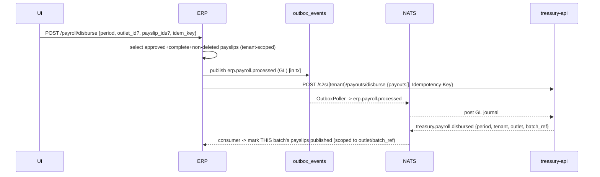

# Sprint 2 — HRM core + Payroll engine (ERP-owned tax)

> **Status: Done** (verified against code on `main` 2026-09-27). Employees, the `payrollengine` package, idempotent disburse with `hrm.payroll.disburse` segregation, and `erp.payroll.processed` are live. Deviation: the `treasury.payroll.disbursed` consumer was removed on 2026-06-15; payslips are marked published on S2S success instead (see `integrations.md`). Follow-ups in `docs/backlog.md`: the payload's empty `cost_center` and the missing per-project cost split, both In progress (plan budgets-planning-projects-bi-2026-09-27).

> The crown jewel. Port employees + the payroll calculation engine and ERP-owned statutory tax
> tables, then wire the treasury disbursement flow. This is where most of `gaps-and-bugs.md §2`
> gets fixed. References: `hrm/payroll/services/core_calculations.py`, `functions.py`,
> `treasury_integration.py`, `disburse_view.py`, `docs/payroll-tax-updates-2025.md`,
> `docs/payroll-audit-report-2025.md`, `erd.md §4-6`, `revamp-plan.md §5`.

## Goals
- Employees CRUD (the FK hub) with full tenant isolation.
- A **pure, deterministic, `decimal`** payroll engine that fails loudly (never silent 0) and
  selects a **single-current, tenant-scoped, effective-dated** rate table.
- End-to-end payroll finalisation: generate → approve → disburse (idempotent) → mark published.

## Scope
### `modules/employees`
- `Employee` (root) + `SalaryDetails`, `HRDetails`, `Contract`, `ContactDetails`, `NextOfKin`,
  `Documents`, `EmployeeBankAccount`, `JobTitle`, `JobGroup`, `WorkersUnion`.
- Every row carries `tenant_id` (+ `outlet_id` where applicable); handlers filter by `claims.TenantID`.
- Recompute derived fields on write (hourly/daily rate, contract duration) instead of trusting stored
  values (fixes `data-migration.md §4` stale-derived note).
- Bank-account "single primary per employee" enforced in a tx (port `EmployeeBankAccountViewSet`).
- Employee import endpoint (port `UploadEmployData`) with explicit tenant scoping (fixes §7 `UploadEmployData`).

### `modules/payroll/payrollengine` (port of `core_calculations.py`)
- Pure functions: progressive PAYE + personal relief resolution; NSSF tiered (Tier 1/2, employee+employer)
  — tier detection from the rate set, **not** a hardcoded `8000` literal (fixes §2.4); SHIF (2.75%, min 300)
  and legacy NHIF with config-driven cutover (no silent hardcoded fallback — error if unconfigured);
  Housing Levy (1.5%); deduction phasing (`before_tax`→`after_tax`→`after_paye`→`final`) via component
  phase/priority + formula `deduction_order` (port `dynamic_deduction_engine.py`).
- **`decimal` throughout**; one internal precision (18,4). **No `except → return 0`**: unresolved
  formula ⇒ typed error ⇒ run aborts (fixes §2.2).
- Employee recoverables (loans/advances/loss-damages/non-cash benefits) computed **purely** (no
  `loan.save()` inside calc — persistence is a separate atomic step, fixing §2.7); capped at outstanding;
  effective-dated.

### `modules/payroll` (transactions)
- `Payslip` (+ audit), `Earnings`, `Deductions`, `Benefits`, `EmployeLoans`, `Advances`,
  `LossesAndDamages`, `ExpenseClaims`(+`ClaimItems`), `CustomReport`.
- Per diem policy and external claims (2026-10-10, `98ec720`): `hrm.per_diem_policy` (daily rate,
  job group rates, minimum trip distance, max days, auto approve) and `POST /hrm/claims/external`
  (idempotent on `source_key`, `expense_claims.metadata` jsonb + GIN). Logistics raises staff
  riders' per diem through it. Open: erp-ui policy card under payroll settings, and showing the
  claim source (logistics trip) on the claims list.
- Payslip generation (port `payroll/views.py` actions + `tasks.py`): batch generate, single rerun,
  casual/consultant voucher; run as background goroutines/NATS jobs (replace Celery).

### `modules/payrollsettings` — **ERP-owned tax tables** (`revamp-plan.md §5`)
- `PayrollFormula`, `PayrollFormulaItem`, `PayrollSplitRatio`, `PayrollRelief`, `PayrollComponent`,
  `WithHoldingTax`, `BenefitTax`, `GeneralHRSettings` (per-tenant, not singleton), `RepayOption`,
  `SeverancePay`, `ScheduledPayslip`.
- All carry `tenant_id`, `effective_from/to`, `version`, `is_current` with a **DB partial unique index**
  enforcing one current per (tenant, type, category) — fixes §2.3 (the disabled `save()` invariant).
- `cmd/seed`: KRA national defaults as a system/default-tenant set (Feb-2025 PAYE brackets, NSSF tiers,
  SHIF 2.75%, Housing 1.5%, relief repeals per `payroll-tax-updates-2025.md`); tenants inherit until they override.
- **Do NOT** read treasury `/s2s/{tenant}/taxes` for payroll rates.

## Endpoints (parity with Django, tenant-scoped)
- `GET/POST/PUT/DELETE /api/v1/hrm/employees/...` (+ salary/hr/contract/bank/contacts/kin/docs subroutes).
- `POST /api/v1/hrm/payroll/generate`, `.../rerun`, `.../vouchers/{casual,consultant}`.
- `GET /api/v1/hrm/payroll/payslips/...`.
- `GET/POST .../payroll-settings/formulas[/effective|/history|/relief-status]` (port `payroll_settings/views.py`).
- `POST /api/v1/hrm/payroll/disburse/` — see flow below.

## Payroll → treasury flow (idempotent)

- Idempotency: a per-batch guard (`IdempotencyKey` / unique `batch_ref`) prevents double publish/disburse
  (fixes §2.8). `treasury.payroll.disbursed` handler scopes by tenant **and** outlet/batch_ref (fixes §2.9).
- Keep `erp.payroll.processed` payload + `/payouts/disburse` body byte-compatible (`integrations.md §1,§6`).
- Net pay and statutory amounts sent as **`decimal` strings**, not floats (fixes §2.1).

## Events
- OUT: `erp.payroll.processed`.
- IN: `treasury.payroll.disbursed`.

## Acceptance criteria
- Tenant A cannot list/generate/disburse tenant B's payslips (automated test).
- Golden-master: feed known gross/period/config → engine returns PAYE/relief/NSSF/SHIF/levy/net matching
  KRA worked examples and the migrated last-period payslips to the cent.
- Misconfigured/missing formula ⇒ run fails with a clear error; no zeroed statutory line, no stale-2017
  NHIF silently applied.
- Two identical disburse POSTs ⇒ one GL event, one payout request (idempotent).
- Multiple `is_current` for the same (tenant,type,category) is impossible (DB rejects).
- All money fields are `decimal`; no `float` in the payroll/disburse path.

## Dependencies
- Sprint 1 (auth, tenant ctx, outbox, S2S, seed).
- Treasury must accept an idempotency key on `/payouts/disburse` (coordinate; otherwise ERP enforces
  single-disburse-per-batch locally as the guard).
