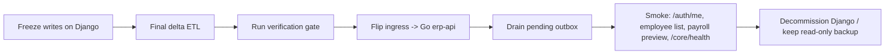

# Sprint 5 — Data migration & cutover (prod Postgres → Go/Ent)

> Move the **real prod HR/payroll data** into the new Go `erp` database and cut over. Local
> `bengo_erp` has only RBAC/framework seed (zero business rows), so the migrator is built/tested
> against a **prod snapshot**. Full table mapping and gotchas live in `data-migration.md` — this
> sprint executes it. References: `data-migration.md`, `erd.md`, `revamp-plan.md §6`.

## Status: Done (verified 2026-09-27)

The cutover is complete: commit `1e25504` (2026-08-30) removed `cmd/migrate-data` as "completed Django-to-Go ERP cutover migration tool", and the repo no longer contains the Django app. The notes below are kept as history.

### Earlier status: migrator built, prod run pending

**DONE (build + verify without prod):**
- `cmd/migrate-data` — one-shot Django→Ent ETL in the SAME DB (plan §0c). Idempotent
  (deterministic UUIDv5(`table:id`) PKs + skip-if-exists/upsert-by-natural-key), FK-ordered,
  tenant backfill via `employee.organisation → business_details.tenant_id` (un-resolvable rows
  skipped, never guessed). Decimal money (never float), datetimes → `Africa/Nairobi`,
  month-abbrev typo fix, `user_id` not carried (SSO JIT). Degrades cleanly on missing
  source table/column.
- Flags: `--dry-run`, `--only=<table>`, `--verbose`, `--default-tenant`; end-of-run
  source-vs-written **reconciliation report** with a parity check.
- Tables migrated: departments, jobtitles→job_titles, business_details→company_settings,
  document_sequences (carries `current_sequence`), leave_leavecategory→leave_categories,
  employee, employee_bank_accounts, employee_hr_details→hr_details,
  employee_salary_details→salary_details, employees_contract→contract, payslips→payslip
  (golden-master), leave_leaverequest→leave_request. (Other KEPT tables follow the same
  per-table pattern in `migrate_*.go` — extend before prod run if they hold rows.)
- Unit tests: decimal (no float drift), legacy-id→UUID determinism/namespacing, month mapping.
- **Local dry-run green** against `bengo_erp` (Django schema, zero business rows): all tables
  `read=0`, `parity: OK`, no writes.
- Operator runbook: [`../data-migration-runbook.md`](../data-migration-runbook.md).

**PENDING (coordinated prod step — needs prod DB access):**
- Prod assessment (per-table counts), dry-run on a restored prod copy, parity gate
  (row counts + FK integrity + non-null tenant + payroll golden-master), final delta,
  flip ingress, drop legacy tables. **NOT run** — no prod connection used during build.

## Goals
- A reliable, idempotent, FK-ordered `cmd/migrate-data` that copies prod rows into Ent, assigns UUIDv7
  PKs, backfills `tenant_id` on every HR row, and verifies parity — then an offline cutover.

## Scope

### 1. Prod assessment
- `pg_dump --schema-only` for reference; `SELECT relname, n_live_tup FROM pg_stat_user_tables ORDER BY 2 DESC`
  for real counts. Identify NULL-`organisation` employees (will need a default tenant or quarantine).
- Confirm prod DB location (shared `postgresql-0`, per-service DB — see Postgres-topology memory).

### 2. `cmd/migrate-data` (the migrator)
- Preferred: `postgres_fdw` foreign tables (`legacy.*`) + Ent typed inserts, one tx per table batch.
- **ID strategy**: new UUIDv7 PKs + indexed `legacy_id bigint` for FK remap; drop `legacy_id` post-verify.
- **Tenant backfill**: derive `tenant_id` for every HR row via
  `Employee.organisation → business_details.tenant_id`; stamp onto all tenant-scoped tables. **Hard-fail**
  if any in-scope row resolves to NULL `tenant_id` (no silent cross-tenant leak — `revamp-plan.md` risk table).
- **FK load order** per `data-migration.md §3`: identity/RBAC → core reference → business → addresses →
  HR core (employees + details) → attendance → payroll settings → payroll txns → leave →
  appraisals/perf/recruitment/training → approvals (typed-remap) → system (outbox pending only).
- **Type mapping** per `data-migration.md §2`: Decimal→`decimal` (normalize 2/4 dp to 18,4);
  djmoney `<f>`+`<f>_currency`→ decimal+currency; GenericFK→ typed `module`+UUID `object_id` (drop
  dangling/decomposed targets); Image/File→ relative path (copy media to PVC); dates → `Africa/Nairobi`.
- **Do NOT carry**: `published` outbox rows; Fernet FX ciphertext (re-enter key); decomposed-module
  permissions and dangling approvals; most `CustomUser` rows (let JIT recreate from JWT `sub` — migrate
  only signature/prefs/`must_change_password` keyed by `external_id`).
- **Re-seed** (not copy): 14 RBAC roles + HR permissions and KRA payroll formulas via `cmd/seed`; migrate
  only user→role assignments by `external_id`.
- **Preserve exactly**: effective-dated formula fields (`effective_from/to/is_current/version`) and
  `DocumentSequence.current_sequence` (so numbering doesn't restart).
- Idempotent: upsert on `legacy_id`/`external_id` so it can be re-run during rehearsal + final delta.

### 3. Media migration
- Copy `media/` (signatures, passports, logos, stamps, documents, resumes) to the Go service PVC;
  rewrite `ImageField`/`FileField` paths to the relative convention (media-image-convention memory).

### 4. Verification (parity gate — must pass before cutover)
- Row-count parity per in-scope table (source vs target), excluding deliberately-skipped tables.
- FK integrity: zero orphans (every employee→user/org, payslip→employee, etc.).
- **Tenant assertion**: every HR row has non-null `tenant_id`; spot-check no cross-tenant bleed.
- **Payroll golden-master**: re-run the Go engine for the last closed period for N employees and compare
  net/PAYE/NSSF/SHIF/levy against the migrated `payslips` rows — zero-cent diff (also satisfies S2 criteria).

### 5. Cutover (offline; HR is not real-time critical)

## Acceptance criteria
- Migrator runs idempotently on a prod snapshot end-to-end with a clean reconcile report.
- All parity checks pass (row counts, FK integrity, non-null `tenant_id`, payroll golden-master).
- Media files present and resolvable in the Go service.
- Post-cutover smoke tests green; downstream services (treasury/notifications) see identical event/S2S
  contracts and need no change.
- Rollback plan documented (Django kept read-only until parity confirmed in prod for one full payroll cycle).

## Dependencies
- Sprints 1-4 (full schema + endpoints must exist to verify parity).
- Prod snapshot access; PVC for media; coordination window for the write freeze.
